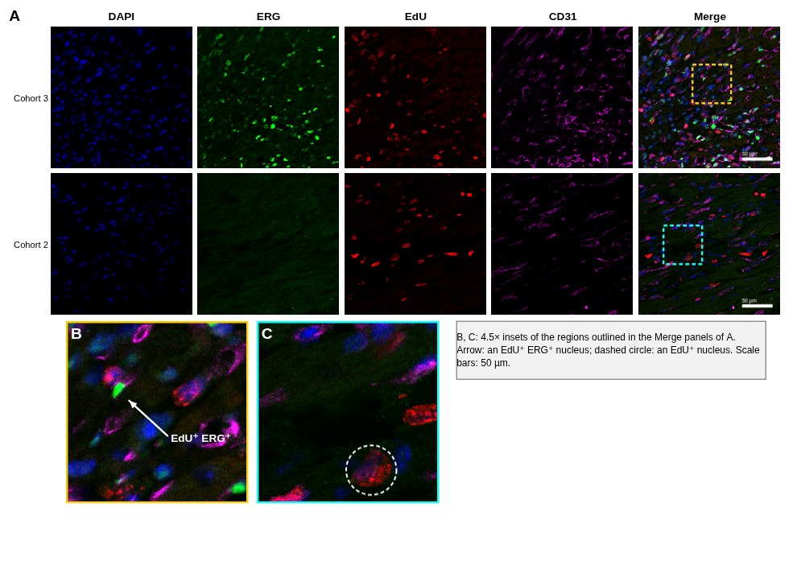

<p align="center">
  
</p>

# FluoForge

A browser-based figure editor for multichannel microscopy images.

Import TIFF stacks straight from ImageJ/Fiji, choose which channels to show and how bright they are, lay the panels out on a page, add scale bars, insets, arrows, shapes and labels, and export a publication figure as TIFF, SVG or PDF. The original image data stays inside the project, so every display setting remains editable, and exports are recomposited from it at full resolution.

**[Open FluoForge](https://remybonnav.github.io/FluoForge/)**: nothing to install, nothing uploaded. Your images never leave your browser.



## Quick start

1. Open the [live app](https://remybonnav.github.io/FluoForge/) in Chrome, Edge or Firefox, or run it locally (below).
2. Click **Create figure** and choose the page size and DPI.
3. **Import Image**: multichannel TIFFs (8, 12, 16 or 32-bit float, RGB), ImageJ hyperstacks and OME-TIFFs (Z, time), or JPEG, PNG and BMP. For CZI, LIF and ND2, the Fiji macro `tools/Export_for_FluoForge.ijm` converts a folder to OME-TIFF.
4. Set each image's channels, colours and display range in the **Channels** panel (with a histogram and ImageJ-style **Auto** contrast), then arrange the panels with the **Grid** tool.
5. **Quick figure** turns a multichannel image into a row of linked panels (each channel and the merge, with coloured column headers) in one click. Add scale bars, insets, text, shapes and arrows, and a channel legend (each channel's name in its colour) with the **Legend** tool.
6. **Save Project** (a `.fluoforge` file you can reopen and edit), then **Export** as TIFF, PNG, SVG (at the page's real size, for Inkscape and Illustrator) or PDF (the **Export…** dialog sets pages, resolution in dpi, ppi, dpc or ppc, transparency, TIFF compression and the figure report). **Export panels (zip)** gives each panel at source resolution and each channel in grey, as journals ask. **Copy out** (top bar, right-click menu or Ctrl+Shift+C) puts the page or the selection on the clipboard as an SVG picture, a PNG or SVG code, to paste into PowerPoint, Word, Inkscape, Illustrator or Figma. **Export ▸ Figure report…** lists each panel's source file (with its SHA-256), crop, projection and channel display settings as Markdown, CSV or JSON, with a ready-to-paste Methods paragraph; SVG and PDF exports embed it. The **Check figure** panel flags missing scale bars and labels, red-green merges, clipped channels, low resolution, text outside 5–8 pt and more before you export. **Vision** in the top bar previews the canvas with deuteranopia, protanopia, tritanopia or in grey-scale, without changing the figure. **Preferences** (Ctrl+,) sets snapping (which edges, distance, guides) and default text, globally or for one project only.

The **[user manual](docs/MANUAL.md)** explains every tool step by step, with screenshots.

### Run it locally

FluoForge is a static page with no build step. From the project folder:

```bash
python3 -m http.server 8765 --bind 127.0.0.1
```

Then open `http://127.0.0.1:8765/`. It works offline: every library and font is bundled in `assets/vendor/`, and a strict Content-Security-Policy stops the page from loading anything from another site. Any static host works (GitHub Pages, an intranet folder). Opening `index.html` directly from disk does not, because browsers do not load modules from `file://`.

## Contributing

Tests, the release script and the project layout are described in [CONTRIBUTING.md](CONTRIBUTING.md). What changed in each version is in [CHANGELOG.md](CHANGELOG.md).

## Licence

From v0.1.0, FluoForge is licensed under the [GNU Affero General Public License v3.0 only](LICENSE) (AGPL-3.0-only). Copyright (C) 2026 Remy Bonnavion.

A commercial licence is available for organisations that want to use, modify, embed or host FluoForge without the AGPL obligations, or that need an invoice, support or deployment help. See [COMMERCIAL-LICENSE.md](COMMERCIAL-LICENSE.md).

Third-party libraries and fonts keep their own licences; see [THIRD-PARTY-NOTICES.md](THIRD-PARTY-NOTICES.md). Contributions need a signed Contributor License Agreement; see [CONTRIBUTING.md](CONTRIBUTING.md). Click the FluoForge name in the app's top bar to see the version, licence and a link to its source code.
