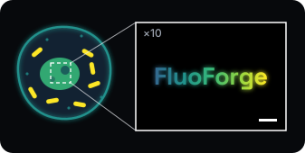

<p align="center">
  
</p>

# FluoForge

A browser based figure editor for multichannel microscopy images.

Read the **[user manual](docs/MANUAL.md)** for a step-by-step guide with screenshots.

## Run locally

From the project directory, run `python3 -m http.server 8765 --bind 127.0.0.1` and open `http://127.0.0.1:8765/`.

FluoForge works offline and makes no third-party requests:

- Every library is vendored in `assets/vendor/`, and `assets/vendor/VERSIONS.md` pins each one with its version, source URL and SHA-256.
- A strict Content-Security-Policy in `index.html` lets the page load only files from its own site.

The workspace starts empty. Choose **Create figure** or **Open project** to begin; creating a figure shows the document page and enables editing. The right inspector has collapsible sections and brings the active tool or selected object's settings to the top. **Theme** offers light lavender, light sage, dark plum, and dark slate; your choice is remembered in this browser. Color palettes include bright colors, pastels, darker shades, and grays. New shapes and paths start with a yellow stroke.

## Selection bar, locks and navigation

While a figure is open, a fixed-height bar under the top bar shows the selection's X, Y, W, H and rotation, the **Lock position** toggle, and (for two or more objects) align, distribute and group. Selecting objects never moves, opens or closes inspector panels; sections only collapse or expand through their own header toggle or **Collapse all**, and that choice is remembered.

The layers panel has three toggles per row: the eye (show/hide, with **Show all** and **Hide all**), the padlock (layer lock: the object cannot be selected, moved, edited or deleted), and the crosshair (position/size lock: the object cannot be moved, resized or rotated, but channels, colors, contrast and text stay editable). Both locks are saved with the project and survive undo/redo. Align, distribute and grid layout leave locked objects in place, and a multi-selection containing a locked object cannot be dragged or grouped.

Zoom buttons and the `+`, `-` and `0` keys zoom around the selected object, or the view center when nothing is selected; Ctrl+wheel zooms around the selection or the cursor. **Fit selection** (Shift+2) fits the selection in view. Hold Shift while rotating to snap to 45°.

## Pages

A figure can have several pages of the same size: **+ Page** in the top bar (or **Add page** in Document Properties) adds one below the last, and the page menu next to it scrolls to a page. Objects can be dragged between pages, and links (insets, scale bars) work across pages. PDF export writes one PDF page per figure page; SVG and TIFF export write one file per page (`name_page-1.svg`, …). Objects left on the pasteboard are not exported.

## Scale bars

With the Scale bar tool active, the bar the buttons would add is previewed (inside a dashed frame) on the reference image, or on every selected image, and follows the length, thickness, color, label, corner and margin fields; nothing is added until you click a button. Selecting an existing scale bar, with any tool, shows its length in µm, the image it belongs to, that image's pixel size and the bar's length in image and page pixels; changing a field then edits the selected bar(s). The layer list and the selection bar also show each bar's length.

## Z stacks and time series

ImageJ hyperstacks (TIFFs saved by ImageJ/Fiji with `slices=` and/or `frames=` in their header) open as their real channels, not one channel per plane: a 4-channel, 5-slice stack shows 4 channels. The Channels panel then shows the stack size and a **Z display** choice: **Maximum intensity projection** (the default), **Mean intensity projection** or **Single slice** with a slice slider. Time series get a **frame** slider. Contrast, colors and channel toggles apply to whatever plane is shown. The choice is per image (an inset keeps its own), works on several selected stacks at once, appears in the History panel, is saved with the project and is used for export. TIFFs without an ImageJ header, or whose header does not match the page count, still open with one channel per page.

**Image info** (Channels panel) shows what was read from the selected image's file: dimensions, bit depth, channels, Z and T, pixel size and its source, and the raw ImageJ header. Importing prints nothing to the browser console; open the app with `?debug=1` (or set `localStorage.fluoforgeDebug = '1'`) to see the TIFF reader's detailed log.

## Editing several objects at once

With several images selected, the Channels panel edits all of them: turning a channel on or off, its color, min/max, brightness, contrast and pixel size are applied to the same channel number on each image, and only the setting you change is copied. The Shape, Pen/Path, Inset outline, Text and Scale bar panels work the same way for several selected objects of their kind.

## Crop to a shape

Draw a box, ellipse (Shape tool, Ellipse; Shift for a circle) or closed pen path over an image, select both, and click **Crop to shape** in the selection bar. The image's frame is cropped to the shape's bounding box (so its selection box, layout and export cover only the shape), and the shape becomes the image's clipping path: it moves, scales and rotates with the image, is saved with the project and stays a vector clipping path in SVG and PDF. **Remove shape crop** gives the shape back as an editable shape and restores the image's previous frame.

## Undo history

The **History** panel lists every step (for example "Added a.png", "Moved scale bar 20 µm", "Changed channels of 2 objects", "Cropped b.png to shape") with its time. Click a step to go back to it; the later steps stay listed for redo until you make a new change. Ctrl+Z / Ctrl+Y step one at a time; up to 200 steps are kept.

## Text boxes

A text box has its own size, independent of the font size. Set W/H in the selection bar or drag the side and top/bottom handles to resize the box; corner handles scale the text, and the size field always shows the real font size. **Top**, **Middle**, **Bottom** and **Center both** position the text inside the box, in the editor and in SVG/PDF/TIFF export.

## Insets of an exact size

While you drag an outline, the Inset panel shows its size on the page, in source-image pixels and (when the image has a pixel size) in µm. In the Inset panel, enable **Exact outline size** and type a width and height in document pixels, then click an image with the Inset tool to place an outline of exactly that size. The fields keep the size of the last outline drawn or placed, so insets on different images match. **Apply exact size to selected outline** resizes an existing outline, and **Inset magnification** sets the size of new insets relative to their outline.

Exports are named after the project (characters that are invalid in file names are replaced). Color pickers include the pure ImageJ channel colors red, green, blue, magenta, cyan and yellow.

## Project files and recovery

Projects saved by earlier versions open in this one, including the v0.18–v0.19 format (scale bars and groups are converted; a v0.18 scale bar's length is read from its label). Closing or reloading the tab with unsaved changes asks for confirmation.

Projects are saved as `.fluoforge` files (named `.mfcproj.zip` up to v0.1.2; both open, and the format is the same zip). They contain `manifest.json`, one editable JSON state per saved version under `versions/`, and one copy of every distinct original import under `sources/`. Save Project updates the current version. Save As creates a child version in a newly selected file and carries the prior history forward.

The browser also keeps bounded recovery checkpoints in IndexedDB. Recovery drafts are offered after reopening only when they are newer than the last manual save. They do not become permanent project versions until the project is saved.

The project panel shows the browser storage used next to the recovery status; after the first draft FluoForge asks the browser to keep this storage (`navigator.storage.persist()`). If storage is full, drafts pause with a clear message and saving to a file keeps working.

Damaged or truncated TIFFs are refused with a message saying why, and nothing is added to the figure. An import that would need more memory than the browser seems to have left asks first. Unexpected errors show a message with **Copy details** (a report for bug reports) instead of failing silently.

Dashed and other uniform-width outlines are written to SVG/PDF as paths in page coordinates, without `vector-effect`, so Inkscape shows the same dash lengths as the editor and keeps them when the shape is resized. PDF export preserves supported text and annotations as vectors and composites microscopy panels from their original channel data. Use Liberation Sans, Liberation Serif, or Liberation Mono for PDF labels; these fonts are bundled and embedded. TIFF export remains flattened and uses the same full resolution panel compositor.

## Pen and editable paths

Choose **Pen / Path** or press `P`. Click to add straight nodes, click and drag to create cubic Bézier handles, and mix both kinds in one path. Double-click or press Enter to finish; Escape cancels; clicking the first node closes the path. Shift constrains new segments and handles to 45° increments, while Ctrl snaps to nearby nodes and object edges or centers.

Select a path and choose **Edit nodes** to move anchors and handles. Double-click a segment to insert a node. The panel can delete the selected node, switch corner and smooth behavior, convert the incoming segment between straight and curved, reopen or close the path, and add tangent-aligned arrowheads. Alt separates the handles while dragging a smooth node. Path nodes and handles remain editable after project save/load, copy/paste, and version restoration.

## Regression checks

### Headless: `npm test`

Node is used only for development; the app itself needs no build and no Node.

```bash
npm ci                                          # Playwright and pdf.js, development only
npx playwright install chromium firefox         # once; add --with-deps on a fresh Linux machine
npm test
```

`npm test` runs `tests/run-headless.mjs`, which:

1. Generates the test images with `tests/generate-fixtures.mjs` (pure Node, no Python).
2. Serves the repository on a local port.
3. Runs every suite of the browser runner in headless Chromium and Firefox, blocking and reporting every request to another origin.
4. Checks the exports of the reference figure (see below).
5. Exits non-zero on any failure.

Useful options, passed after `--`:

- `--browser=chromium`
- `--suite=zstack-regression`
- `--skip-reference`
- `--reference-only`

GitHub Actions runs `npm test` on every push and pull request (`.github/workflows/test.yml`), and deploys `main` to GitHub Pages (`.github/workflows/pages.yml`).

**Reference exports.**
- `tests/fixtures/reference.mfcproj.zip` is a two-page figure that uses every object type: a multichannel TIFF, a raster image, an inset and its outline, a scale bar, text boxes, a rectangle, an ellipse, a line, a pen path with arrowheads, a group, and an image cropped to a shape.
- Its exports are stored next to it as `reference.svg`, `reference.tif` and `reference.pdf`.
- `tests/reference-check.js` reopens the project, exports it again and compares the results:
  - SVG structurally: the same element tree and attributes, numbers within 0.02 px, generated ids normalised, embedded images compared by pixels;
  - TIFF by pixel difference;
  - PDF by pixel difference after rendering both files with pdf.js.
- The tolerances are at the top of that file. The references are Chromium renders.

**Old projects.** `tests/compat/` holds projects saved by earlier versions; they must keep opening (`compat-regression`):
- `main-v0.22-project.mfcproj.zip`: saved by the app before the 0.1.0 reset.
- `v0.1.0-project.mfcproj.zip`: the reference figure, built and saved by FluoForge 0.1.0, extracted from the `v0.1.0` tag. Its four CDN scripts were pointed at the vendored copies, which are byte-identical (see `assets/vendor/VERSIONS.md`).
- After an intended export change, run `npm run make-reference` and explain the difference in the pull request.

### In a browser

Open [the browser regression runner](tests/browser-regression.html) on the local server to run each suite with a fresh app frame and isolated test recovery storage. The interface suite covers empty startup, document creation/opening, themes, collapsible tool panels, and native mouse events for nodes, handles, and insets. It checks the node drag positions at multiple zoom levels with rotated, scaled, skewed, and flipped paths, and verifies that drawing an inset keeps its source image fixed.

With the app open, run the following in the browser console:

```js
const script = document.createElement('script');
script.src = '/tests/regression.js';
document.head.append(script);
script.onload = async () => console.log(await runMfcRegressions());
```

The checks create small synthetic images and verify linked insets, scale bars, mixed copy and duplication, text borders, curve controls, and keyboard movement. The supplied `image1.tif` and `image2.tif` can also be imported to exercise real four-channel TIFF decoding.

The publication export and project-format suite needs a deterministic large multichannel TIFF. `npm test` creates it; to run the suite by hand, first run:

```bash
npm run fixtures
```

Then, in the browser:

```js
const script = document.createElement('script');
script.src = '/tests/project-export-regression.js';
document.head.append(script);
script.onload = async () => console.log(await runProjectExportRegressions());
```

This suite verifies three editable versions, source deduplication, legacy ZIP/JSON/gzip migration, recovery drafts and retention, storage-error reporting, native PDF paths and selectable text, clipping and opacity, explicit font failures, and source-resolution image export.

The Pen/Path suite runs in the browser in the same way:

```js
const script = document.createElement('script');
script.src = '/tests/path-regression.js';
document.head.append(script);
script.onload = async () => console.log(await runPathRegressions());
```

It verifies progressive drawing, mixed straight and cubic segments, node editing and insertion, corner/smooth conversion, Alt handle separation, closure, arrowheads, project persistence, copy/paste, legacy curve migration, and vector SVG/PDF export.

The UI suite (`tests/ui-fixes-regression.js`, also in the browser runner) covers stable inspector panels, the selection bar, font size and text box sizing, vertical text alignment, 45° rotation snapping, selection-centered zoom, both lock types across tools, undo/redo and loading, visibility icons, exact-size insets, export file names, ImageJ swatches, and opening a project saved by v0.22 (`tests/compat/main-v0.22-project.mfcproj.zip`).

The Z stack suite (`tests/zstack-regression.js`, browser runner) builds small ImageJ hyperstacks and checks the channel/slice/frame split, max and mean projections, the slice and frame controls, history labels, undo/redo and saved projects.

The About suite (`tests/about-regression.js`, browser runner) opens the About dialog from the brand and checks the version, copyright, licence links, a source link that contains the running version, keyboard focus, Escape and Close.

The offline suite (`tests/offline-regression.js`, browser runner) checks the Content-Security-Policy, that every script and stylesheet is same-origin, that no resource came from another origin, that the browser blocks a third-party image and fetch, that each vendored file matches its SHA-256 in `VERSIONS.md`, and that every licence file is bundled.

The v0.24 suite (`tests/v024-regression.js`, also in the browser runner) covers opening a v0.18-format project, the live inset size readout, scale bar previews and metadata editing, multi-image channel and multi-shape edits, transform-free dashed SVG outlines, crop to shape, multi-page export, and the close warning.

`assets/vendor/svg2pdf.umd.min.js` carries one local fix (marked at the top of the file): its data-URL pattern no longer overflows the call stack on very large embedded images, which made PDF export fail with "Maximum call stack size exceeded".

## Logo and app icons

The README logo is `assets/FluoForge-logo-Github-viridis.svg`. The app icons (SVG, PNG from 16 to 512 px, `favicon.ico` and the Apple touch icon) are in `assets/FluoForge-app-icons/`; the page uses them as its browser favicon, in the top bar and on the empty workspace.

## Licence

From v0.1.0, FluoForge is licensed under the [GNU Affero General Public License v3.0 only](LICENSE) (AGPL-3.0-only). Copyright (C) 2026 Remy Bonnavion.

A commercial licence is available for organisations that want to use, modify, embed or host FluoForge without the AGPL obligations, or that need an invoice, support or deployment help. See [COMMERCIAL-LICENSE.md](COMMERCIAL-LICENSE.md).

Third-party libraries and fonts keep their own licences; see [THIRD-PARTY-NOTICES.md](THIRD-PARTY-NOTICES.md). Contributions need a signed Contributor License Agreement; see [CONTRIBUTING.md](CONTRIBUTING.md). Click the FluoForge name in the app's top bar to see the version, licence and a link to its source code.
