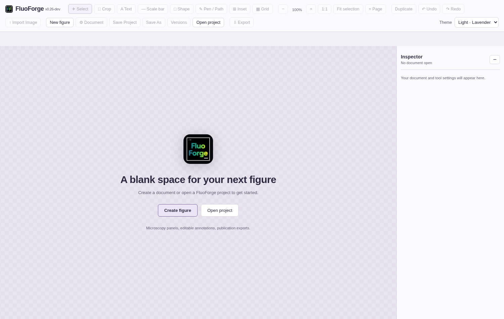
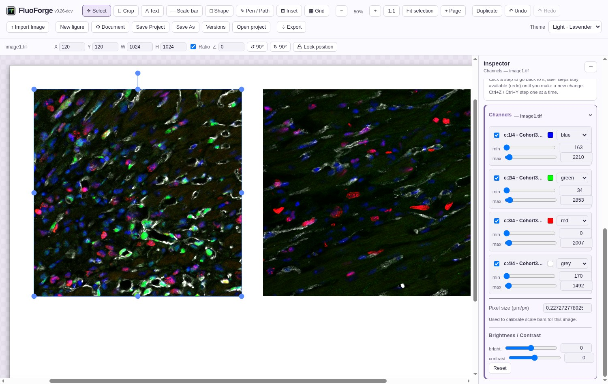
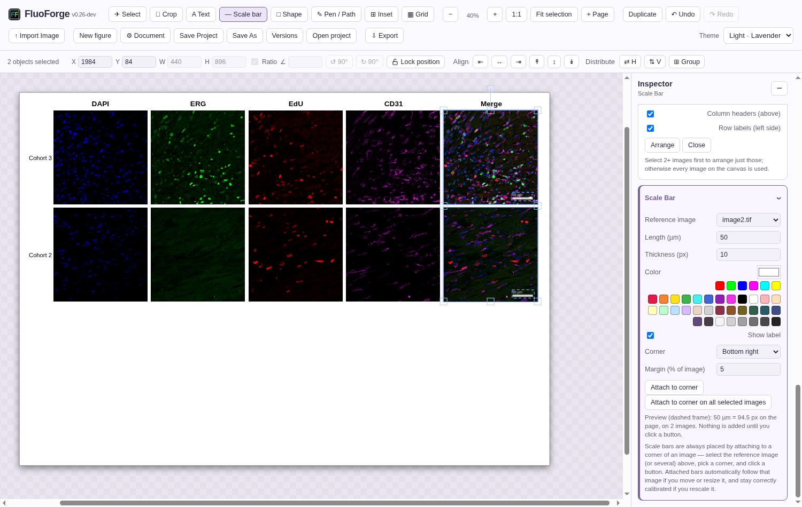
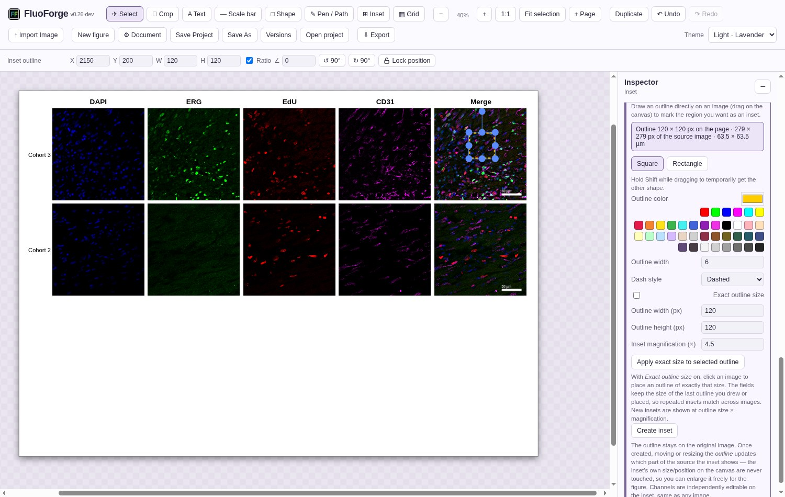
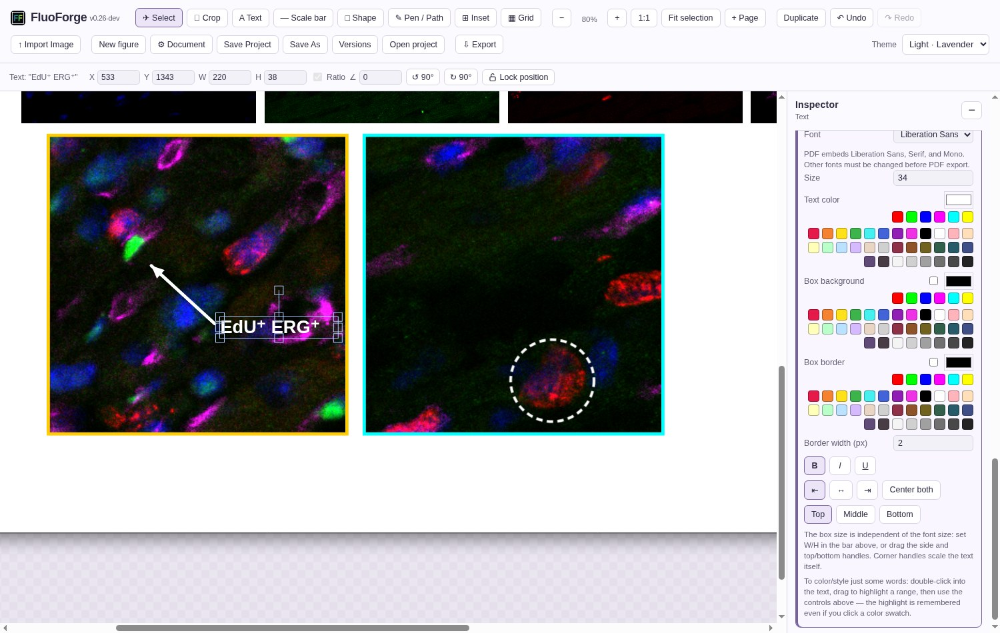
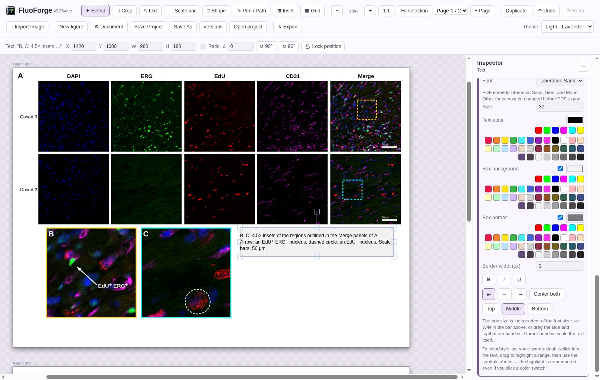
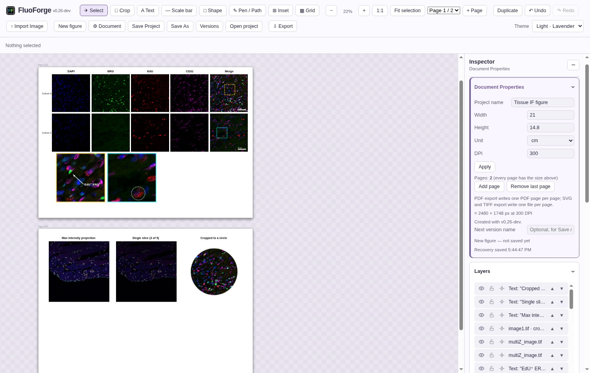
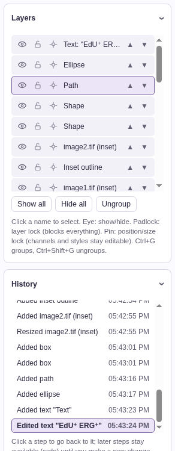
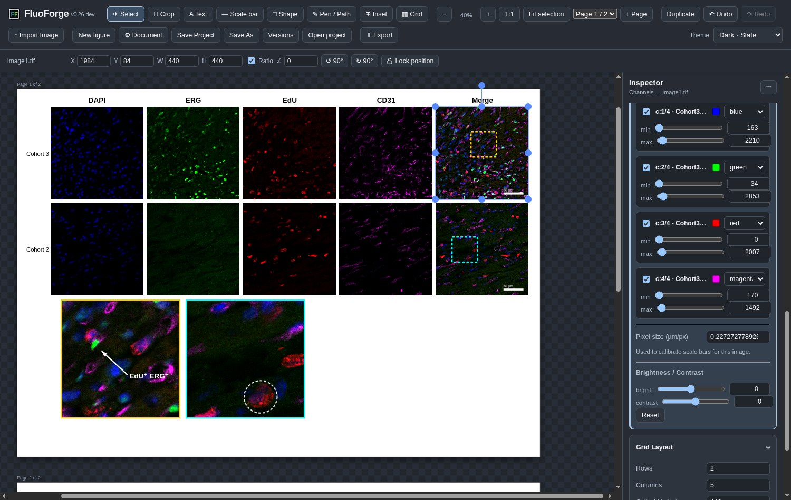

<p align="center">
  
</p>

# FluoForge user manual

FluoForge is a figure editor for multichannel fluorescence microscopy that runs in your web browser. You import TIFF stacks straight from ImageJ/Fiji (or JPEG/PNG/BMP), choose which channels to show and how bright they are, lay the panels out on a page, add scale bars, insets, arrows, shapes and labels, and export a publication figure as TIFF, SVG or PDF. The original image data is kept inside the project, so every display setting stays editable.

The figure below was made entirely in FluoForge, and the rest of this manual shows how. The example images are four-channel immunofluorescence sections (DAPI, ERG, EdU, CD31) from the project author.


## Contents

1. [Starting FluoForge](#1-starting-fluoforge)
2. [The workspace](#2-the-workspace)
3. [Importing images](#3-importing-images)
4. [Channels, contrast and calibration](#4-channels-contrast-and-calibration)
5. [Z stacks and time series](#5-z-stacks-and-time-series)
6. [Laying out panels with the Grid tool](#6-laying-out-panels-with-the-grid-tool)
7. [Selecting, moving, aligning and locking](#7-selecting-moving-aligning-and-locking)
8. [Cropping an image](#8-cropping-an-image)
9. [Scale bars](#9-scale-bars)
10. [Insets](#10-insets)
11. [Shapes](#11-shapes)
12. [Pen and paths (arrows, outlines)](#12-pen-and-paths-arrows-outlines)
13. [Text and captions](#13-text-and-captions)
14. [Cropping an image to a shape](#14-cropping-an-image-to-a-shape)
15. [Pages and document properties](#15-pages-and-document-properties)
16. [Layers](#16-layers)
17. [Undo and the History panel](#17-undo-and-the-history-panel)
18. [Saving, versions and recovery](#18-saving-versions-and-recovery)
19. [Exporting the figure](#19-exporting-the-figure)
20. [Themes](#20-themes)
21. [Keyboard shortcuts](#21-keyboard-shortcuts)
22. [Tips and troubleshooting](#22-tips-and-troubleshooting)

---

## 1. Starting FluoForge

FluoForge is a static web page with nothing to install. In the project folder, start a local web server and open the page:

```bash
python3 -m http.server 8765 --bind 127.0.0.1
```

Then open `http://127.0.0.1:8765/` in Chrome, Edge or Firefox. Chrome and Edge can also save a project back into the same file (see [Saving](#18-saving-versions-and-recovery)).

FluoForge works offline. Every library and font it needs is included in the project folder, so it runs without an internet connection and behind an institute firewall. The page also refuses to load anything from another website: your images never leave your computer.

The workspace starts empty. Click **Create figure** to start a new figure, or **Open project** to continue one you saved.



**Create figure** asks for the page:


| Field | Meaning |
|---|---|
| Project name | Used for the project file and every export file name. |
| Width / Height | Page size, in the chosen unit. The default 21 × 14.8 cm is A5 landscape (half an A4 page). |
| Unit | Pixels, cm or inches. |
| DPI | Output resolution. At 300 DPI a 21 cm page is 2480 pixels wide. Positions and sizes in the editor are in these pixels. |
| Pages | Number of pages (all the same size). You can add pages later. |

Everything except the name can be changed later in [Document properties](#15-pages-and-document-properties).

## 2. The workspace



- **Top bar, first row**: the tools (**Select**, **Crop**, **Text**, **Scale bar**, **Shape**, **Pen / Path**, **Inset**, **Grid**), zoom (− / + / 1:1 / **Fit selection**), the page menu and **+ Page**, then **Duplicate**, **Undo** and **Redo**.
- **Top bar, second row**: **Import Image**, **New figure**, **Document**, **Save Project**, **Save As**, **Versions**, **Open project**, **Export** and the **Theme** menu.
- **Selection bar** (under the top bar): what is selected, its exact position, size and rotation, and the actions that apply to it. See [section 7](#7-selecting-moving-aligning-and-locking).
- **Canvas**: the white page(s) on a checkered pasteboard. Objects left on the pasteboard are kept in the project but are not exported.
- **Inspector** (right): collapsible panels for Document Properties, Layers, History, Channels and the active tool. Click a panel header to collapse or expand it; the **−** button collapses all of them. Which panels are collapsed is remembered. Selecting objects never opens, closes or moves a panel.

**Zoom**: the − and + buttons (or the `-`, `+` and `0` keys) zoom around the selected object, or around the centre of the view when nothing is selected. Ctrl + mouse wheel zooms around the selection or the cursor. **1:1** returns to 100 %, and **Fit selection** (Shift+2) fits the selection in the view.

## 3. Importing images

Click **Import Image** (you can choose several files at once). Supported formats:

| Format | What FluoForge reads |
|---|---|
| TIFF (8- or 16-bit, one page per channel) | Every channel at full bit depth, plus what ImageJ/Fiji saved: channel colours (LUTs), per-channel display ranges, channel labels and pixel size (µm/px). |
| ImageJ hyperstacks (channels × Z slices × time frames) | See [Z stacks and time series](#5-z-stacks-and-time-series). |
| JPEG, PNG, BMP | Three channels (red, green, blue) shown at their full 0–255 range. PNG transparency is kept. These files carry no pixel size; enter it by hand to use scale bars. |

Images keep their full resolution for export. On screen, very large images (more than 2048 px on the long side) are shown with a reduced preview so that editing stays fast.

## 4. Channels, contrast and calibration

Select an image to show its channels in the **Channels** panel (see the screenshot in [section 2](#2-the-workspace)). For each channel:

- **Checkbox**: shows or hides the channel. Single-channel panels are made by duplicating an image and leaving one channel on.
- **Colour menu**: grey, red, green, blue, cyan, magenta, yellow or orange. Channels are added together, as in an ImageJ composite.
- **min / max**: the display range (as in ImageJ's *Brightness & Contrast*). Values below *min* are black; values at or above *max* are full colour. Drag the slider or type a number and press Enter.

Below the channels:

- **Pixel size (µm/px)**: read from the TIFF when available. Type a value to calibrate an image that has none; scale bars need it.
- **Image info**: opens a dialog with what FluoForge found in the selected image's file: format, dimensions, bit depth, channels (colour, display range and where that range came from), Z slices, time frames and Z step, pixel size and where it came from (the file or typed by hand), and the raw ImageJ header. Press Escape or **Close** to close it.
- **Preserve transparency (alpha)**: only for PNGs with transparent areas.
- **Brightness / Contrast**: a tone curve applied to the whole composite. **Reset** sets both to 0.

**Editing several images at once.** With several images selected, the panel edits all of them: a change to channel 2's colour, for example, is applied to channel 2 of every selected image. Only the setting you change is copied; the other settings stay as they were. Use this to give every panel of a figure the same display range, which keeps intensities comparable between conditions.

## 5. Z stacks and time series

TIFFs saved by ImageJ/Fiji as hyperstacks open with their real channels: a stack with 4 channels and 5 Z slices shows 4 channels, not 20. The Channels panel then shows the stack size and a **Z display** choice:

- **Maximum intensity projection** (default): each pixel shows its brightest value across the slices.
- **Mean intensity projection**: the average across the slices.
- **Single slice**: one optical section, chosen with the **slice** slider or by typing its number.

Time series also get a **frame** slider. Colours, display ranges and channel toggles apply to whichever plane is shown.


Each image (and each inset) keeps its own Z display. The choice is listed in the History panel, saved with the project and used when exporting. TIFFs without an ImageJ header still open with one channel per page.

## 6. Laying out panels with the Grid tool

The usual layout of a fluorescence figure is single channels next to the merge, one row per condition. To build it:

1. Import each image once per panel you want (or use **Duplicate**, Ctrl+D), and set each copy's channels in the Channels panel.
2. Select the images in reading order (or select none to use every image), then click **Grid**.
3. Set **Rows**, **Columns**, **Cell width / height** (page pixels) and **Gap**, choose whether to add **Column headers** and **Row labels**, and click **Arrange**.


Each image is fitted into its cell without distortion. The headers and row labels are ordinary text boxes that you then edit (here: DAPI, ERG, EdU, CD31, Merge and Cohort 3 / Cohort 2). Locked images are left in place.

## 7. Selecting, moving, aligning and locking

Use the **Select** tool (`V`). Click an object to select it; Shift+click or drag a rectangle to select several.

- **Move**: drag the object, or nudge it with the arrow keys (1 px; Shift+arrow moves 10 px).
- **Resize / rotate**: drag the handles. Hold Shift while rotating to snap to 45°.
- **Exact values**: type **X**, **Y**, **W**, **H** and the rotation **∠** in the selection bar (page pixels). With **Ratio** ticked, the height follows the width. **↺ 90° / ↻ 90°** rotate by a quarter turn.
- **Duplicate** (Ctrl+D), **Copy / Paste** (Ctrl+C / Ctrl+V), **Delete** (Delete or Backspace).

With two or more objects selected, the bar adds **Align** (left, centre, right, top, middle, bottom), **Distribute** (horizontally or vertically) and **Group** (Ctrl+G; Ctrl+Shift+G ungroups):


**Locks**

- **Lock position** (selection bar, or the crosshair icon in the Layers panel): the object cannot be moved, resized or rotated, but its channels, colours, text and style stay editable. Use it once the layout is final.
- **Layer lock** (padlock icon in the Layers panel): the object cannot be selected, edited or deleted at all.

Align, distribute and the grid leave locked objects where they are, and a selection containing a locked object cannot be dragged or grouped. Both locks are saved with the project and survive undo and redo.

**Editing several objects of one kind.** The Channels, Shape, Pen / Path, Inset outline, Text and Scale bar panels edit every selected object of their kind at once, and only the setting you change is copied.

## 8. Cropping an image

Select an image and choose **Crop** (`C`). Drag the blue handles, or type an exact **Width** and **Height** in pixels; **Square** keeps the crop square. Click **Apply Crop** (or **Cancel**).


Cropping is never destructive: the full image stays in the project. **Uncrop** in the selection bar restores the full frame.

## 9. Scale bars

Scale bars use the image's pixel size, so they stay correct when the panel is resized.

1. Choose **Scale bar** (`S`) and select the image (or several images) that should get a bar.
2. Set **Length (µm)**, **Thickness**, **Color**, **Show label**, **Corner** and **Margin** (% of the image).
3. A dashed preview appears on each selected image, and the panel tells you how long the bar will be on the page. Nothing is added yet.
4. Click **Attach to corner** (the reference image) or **Attach to corner on all selected images**.



An attached bar follows its image when you move, resize or crop it. Selecting an existing bar (with any tool) shows its length in µm, its image, that image's pixel size and the bar's length in image and page pixels; changing a field then edits the selected bar(s). The Layers panel and the selection bar also show each bar's length.

## 10. Insets

An inset is a magnified view of a region of an image. It stays linked to an outline drawn on the source image.

1. Choose **Inset** (`I`), then drag on an image to draw the outline (**Square** or **Rectangle**; hold Shift for the other). While you drag, the panel shows the outline's size on the page, in source pixels and in µm.
2. Set the outline **colour**, **width** and **dash style**, and the **Inset magnification**. New insets are created at the outline size × magnification.
3. Click **Create inset**. The inset appears next to the image; move and resize it freely.



Moving or resizing the *outline* later changes the region the inset shows, without moving the inset itself. An inset has its own channel settings, so you can, for example, show only two channels in the zoom.

**Insets of an exact size.** Tick **Exact outline size** and type a width and height (page pixels), then click on an image to place an outline of exactly that size. The fields remember the last outline, so insets on different images match. **Apply exact size to selected outline** resizes an existing outline.

## 11. Shapes

Choose **Shape** (`R`), pick **Box**, **Ellipse** or **Line**, and drag on the canvas, including on top of an image. Hold Shift (or choose **Square**) for a square or a circle. Set **Stroke color**, **Stroke width**, **Dash style** (solid, dashed, dotted, dash-dot, long dash) and an optional **Fill**. Selecting a shape shows the same panel, and its changes apply to every selected shape.


The coloured frames around insets B and C are boxes drawn with this tool, in the same colours as the outlines.

New shapes and paths start with a yellow stroke. The colour pickers offer bright colours, pastels, darker shades and greys, plus the pure ImageJ channel colours (red, green, blue, magenta, cyan and yellow), so outlines can match a channel exactly.

## 12. Pen and paths (arrows, outlines)

Choose **Pen / Path** (`P`) to draw lines, arrows and free outlines.

- Click to add a straight node; click and drag to pull out Bézier handles for a curve. Straight and curved segments can be mixed.
- Double-click or press Enter to finish, and Escape to cancel. Clicking the first node closes the path.
- Shift constrains to 45° angles. Ctrl snaps to nearby nodes and object edges or centres.
- Style: colour, width, opacity, dash style, line cap and join, and an **arrow** at the start and/or end.

To change a path later, select it and click **Edit nodes**: drag nodes and handles, double-click a segment to insert a node, and use **Corner / Smooth**, **Delete node**, **Straight segment / Curve segment** and **Close path**. Hold Alt while dragging a smooth node's handle to break the symmetry. **Done editing** returns to normal selection.


## 13. Text and captions

Choose **Text** (`T`) and click where the label should go, including on top of an image, then type. Click an existing text box to edit it.



- **Font, Size, Text color, Bold / Italic / Underline.** Liberation Sans, Liberation Serif and Liberation Mono are built in and embedded in PDF exports; change other fonts to one of these before exporting a PDF.
- **Box**: a text box has its own width and height, independent of the font size. Drag the side and top/bottom handles (or type W/H in the selection bar) to resize the box; corner handles scale the text itself. The **Size** field always shows the real font size.
- **Alignment**: left / centre / right, and **Top / Middle / Bottom** inside the box. **Center both** centres it both ways.
- **Box background** and **Box border** (with **Border width**) turn a text box into a caption or a label patch.
- **Styling part of the text**: double-click into the text, highlight some words, and use the controls (colour, bold…). This is how superscripts and coloured words are made.



## 14. Cropping an image to a shape

To show an image inside a circle, an ellipse or any closed outline:

1. Draw a box, an ellipse (Shift for a circle) or a closed pen path over the image.
2. Select the image and the shape together. **Crop to shape** appears in the selection bar.


3. Click **Crop to shape**. The image frame is cropped to the shape, and the shape becomes the image's clipping path. It moves, scales and rotates with the image and stays a true vector clip in SVG and PDF.


**Remove shape crop** (selection bar) gives the shape back as an editable shape and restores the image's previous frame.

## 15. Pages and document properties

A figure can have several pages of the same size. **+ Page** (top bar) or **Add page** (Document Properties) adds a page below the last one; the page menu next to it scrolls to a page. Objects can be dragged between pages, and scale bars and insets keep working across pages.




Click **Document** (or open the **Document Properties** panel) to change:

- **Project name**, **Width**, **Height**, **Unit**, **DPI**: click **Apply**. The pixel size of the page at that DPI is shown below.
- **Add page / Remove last page** (removing a page that still has objects asks first).
- **Next version name**: an optional name for the next **Save As** version.
- The save status, and the time of the last browser recovery checkpoint.

<br clear="right">

## 16. Layers

The **Layers** panel lists every object, frontmost first. Click a name to select the object; the ▲ / ▼ arrows move it forward or backward.



Each row has three toggles:

- **Eye**: show / hide (**Show all** / **Hide all** for every object).
- **Padlock**: layer lock (cannot be selected, moved, edited or deleted).
- **Crosshair**: position/size lock (cannot be moved, resized or rotated; channels, colours and text stay editable).

**Ungroup** splits a selected group.

<br clear="right">

## 17. Undo and the History panel

Every change is a step in the **History** panel, with a readable name and its time ("Added image1.tif", "Moved scale bar 50 µm", "Changed channels of 2 objects", "Changed Z plane of …", "Cropped image1.tif to shape"). Click a step to go back to it. Later steps stay listed for redo until you make a new change. **Undo / Redo** (Ctrl+Z, Ctrl+Y or Ctrl+Shift+Z) move one step at a time, and up to 200 steps are kept.

## 18. Saving, versions and recovery

- **Save Project** (Ctrl+S) writes a `.fluoforge` file containing the editable figure and one copy of every original image, so you can reopen it later and change anything. In Chrome and Edge you pick the file once and later saves overwrite it; other browsers download a new copy each time.
- **Save As** saves to a new file as a new version that keeps the earlier history.
- **What is in the file**: a `.fluoforge` file is a zip with `manifest.json`, one editable state per saved version under `versions/`, and one copy of every distinct original image under `sources/`. **Save Project** updates the current version; **Save As** adds a child version.
- **Versions** lists the versions stored in the project and lets you restore one.
- **Open project** opens a `.fluoforge` file. Projects saved by older FluoForge versions open too: `.mfcproj.zip` files (FluoForge up to 0.1.2) and the older `.mfcproj.json` and `.gz` formats (v0.18–v0.19). Saving such a project writes a `.fluoforge` file; a project that was opened from a file in Chrome or Edge keeps saving to that file until you use **Save As**. In v0.18–v0.19 projects, scale bars and groups are converted, and a scale bar's length is read from its label.
- **Storage**: below the recovery status, FluoForge shows how much browser storage it uses and how much is available. After the first recovery draft it asks the browser to keep this data (Firefox may ask you for permission; allowing it stops the browser from clearing drafts when space runs low). If the browser storage is full, the recovery status says so and drafts pause; your figure is not affected, so save it to a file. Drafts resume when space is freed.
- **Recovery**: while you work, the browser keeps recovery checkpoints. If the tab is closed or crashes, FluoForge offers to recover the draft the next time it opens (only when the draft is newer than your last save). Recovery drafts are not a replacement for saving, and they do not become project versions until you save.
- Closing or reloading the tab with unsaved changes asks for confirmation.

## 19. Exporting the figure

**Export** offers three formats:


| Format | What you get | Use it for |
|---|---|---|
| **TIFF (flattened RGB)** | One RGB image per page at the document DPI, with the DPI written in the file. | Journals that want raster figures; quick previews. |
| **SVG** | One file per page. Text, shapes, paths, arrows, scale bars and clip paths stay as vectors; each image is embedded (cropped) at the output resolution, never enlarged beyond its source pixels. | Final touches in Inkscape or Illustrator. |
| **PDF** | One PDF with one page per figure page; vectors stay vectors and the Liberation fonts are embedded. | Submission and sharing. |

Images are always re-composited from the original channel data at full resolution, never from the screen preview. Dashed outlines keep their dash lengths in Inkscape and when resized. Export files are named after the project (characters that are not allowed in file names are replaced), and multi-page SVG/TIFF exports add `_page-1`, `_page-2`, … Objects on the pasteboard (outside a page) are not exported.

## 20. Themes

**Theme** (top right) switches the interface between Light · Lavender, Light · Sage, Dark · Plum and Dark · Slate. It does not change the figure, and the choice is remembered in this browser.



## 21. Keyboard shortcuts

| Keys | Action |
|---|---|
| `V` | Select tool |
| `C` | Crop tool |
| `T` | Text tool |
| `S` | Scale bar tool |
| `R` | Shape tool |
| `P` | Pen / Path tool |
| `I` | Inset tool |
| `+` / `-` | Zoom in / out (around the selection) |
| `0` | Zoom to 100 % |
| Shift+2 | Fit the selection in the view |
| Ctrl + mouse wheel | Zoom around the selection or the cursor |
| Arrow keys / Shift+arrows | Nudge by 1 px / 10 px |
| Ctrl+Z | Undo |
| Ctrl+Y or Ctrl+Shift+Z | Redo |
| Ctrl+D | Duplicate |
| Ctrl+C / Ctrl+V | Copy / paste |
| Ctrl+G / Ctrl+Shift+G | Group / ungroup |
| Ctrl+S | Save project |
| Delete or Backspace | Delete the selection (locked objects are kept) |
| Shift (while drawing) | Square / circle; 45° for paths and rotation |
| Ctrl (Pen tool) | Snap to nodes and object edges |
| Alt (editing nodes) | Break a smooth node's handles |
| Enter / Escape (Pen tool) | Finish / cancel the path |

## 22. Tips and troubleshooting

- **A stack opens as many channels.** The file has no ImageJ hyperstack header (or its header does not match the number of pages). **Image info** shows the header and says when it does not match. In Fiji, use *Image ▸ Hyperstacks ▸ Stack to Hyperstack* and save as TIFF.
- **Checking what was read from a file.** Select the image and click **Image info** in the Channels panel. For more detail, open FluoForge with `?debug=1` at the end of the address (or run `localStorage.fluoforgeDebug = '1'` in the browser console and reload): the TIFF reader then prints everything it decodes to the console. Importing is silent otherwise.
- **No scale bar can be added.** The image has no pixel size. Type it in the Channels panel (**Pixel size (µm/px)**).
- **Comparing conditions.** Select all panels of one channel and set the same *min / max*: the multi-image edit copies only the value you change.
- **PDF text looks different.** Only the Liberation fonts are embedded in PDF; switch labels to Liberation Sans, Serif or Mono.
- **Large images feel slow.** The editor shows a reduced preview above 2048 px; exports still use the full resolution.
- **"needs about … of memory" when importing.** FluoForge estimates the memory an image needs (width × height × planes × bytes per sample) and asks before opening one that would exceed what the browser seems to have left. Opening it anyway may crash the tab: save first, or close other tabs.
- **A file cannot be imported.** The message says why, for example "is not a TIFF file" or "is damaged or incomplete" (often a file that was not fully copied or downloaded). Nothing is added to the figure.
- **"Unexpected error" message.** Something went wrong inside FluoForge. The figure stays editable; save it, then use **Copy details** and paste the report into a bug report. **Dismiss** or Escape closes the message.
- **Lost work.** Reopen FluoForge in the same browser: a recovery prompt appears if a draft newer than your last save exists. Save projects regularly anyway: browser storage can be cleared.
