<p align="center">
  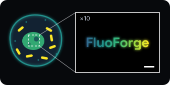
</p>

# FluoForge user manual

FluoForge is a figure editor for multichannel fluorescence microscopy that runs in your web browser. You import TIFF stacks straight from ImageJ/Fiji (or JPEG/PNG/BMP), choose which channels to show and how bright they are, lay the panels out on a page, add scale bars, insets, arrows, shapes and labels, and export a publication figure as TIFF, SVG or PDF. The original image data is kept inside the project, so every display setting stays editable.

The figure below was made entirely in FluoForge, and the rest of this manual shows how. The example images are four-channel immunofluorescence sections (DAPI, ERG, EdU, CD31) from the project author.

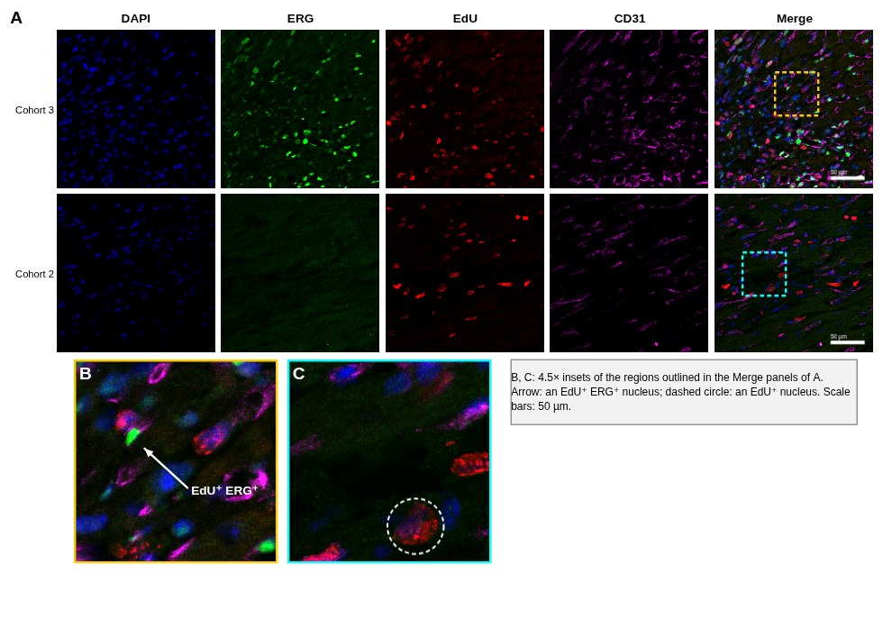

## Contents

1. [Starting FluoForge](#1-starting-fluoforge)
2. [The workspace](#2-the-workspace)
3. [Importing images](#3-importing-images)
4. [Channels, contrast and calibration](#4-channels-contrast-and-calibration)
5. [Z stacks and time series](#5-z-stacks-and-time-series)
6. [Laying out panels with the Grid tool](#6-laying-out-panels-with-the-grid-tool)
7. [Selecting, moving, aligning and locking](#7-selecting-moving-aligning-and-locking)
8. [Cropping an image](#8-cropping-an-image)
9. [Scale bars](#9-scale-bars)
10. [Insets](#10-insets)
11. [Shapes](#11-shapes)
12. [Pen and paths (arrows, outlines)](#12-pen-and-paths-arrows-outlines)
13. [Text and captions](#13-text-and-captions)
14. [Cropping an image to a shape](#14-cropping-an-image-to-a-shape)
15. [Pages and document properties](#15-pages-and-document-properties)
16. [Layers](#16-layers)
17. [Undo and the History panel](#17-undo-and-the-history-panel)
18. [Saving, versions and recovery](#18-saving-versions-and-recovery)
19. [Exporting the figure](#19-exporting-the-figure)
20. [Themes](#20-themes)
21. [Keyboard shortcuts](#21-keyboard-shortcuts)
22. [Tips and troubleshooting](#22-tips-and-troubleshooting)

---

## 1. Starting FluoForge

FluoForge is a static web page with nothing to install. In the project folder, start a local web server and open the page:

```bash
python3 -m http.server 8765 --bind 127.0.0.1
```

Then open `http://127.0.0.1:8765/` in Chrome, Edge or Firefox. Chrome and Edge can also save a project back into the same file (see [Saving](#18-saving-versions-and-recovery)).

FluoForge works offline. Every library and font it needs is included in the project folder, so it runs without an internet connection and behind an institute firewall. The page also refuses to load anything from another website: your images never leave your computer.

The workspace starts empty. Click **Create figure** to start a new figure, or **Open project** to continue one you saved.


**Create figure** asks for the page:

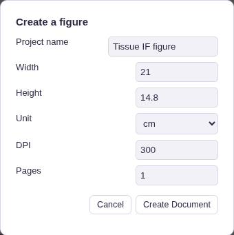

| Field | Meaning |
|---|---|
| Project name | Used for the project file and every export file name. |
| Journal / Width preset | Optional. Choose a journal (Nature, Science, Cell Press, PNAS, JCI, PLOS ONE or JCB) or **Generic** (85, 114 or 174 mm), and one of its figure widths, such as single column, 1.5 column, double column or full page: the width and height are filled in, in cm, with the height kept within the journal's maximum. The line below gives the journal's text sizes, resolution and formats, and the author guidelines they were read from, with the date. The [figure check](#checking-the-figure-before-export) then uses the journal's text limits. Only values stated in each journal's guidelines are included; journals whose guidelines could not be read are not listed. The presets are in `presets/journals.json`. |
| Width / Height | Page size, in the chosen unit. The default 21 × 14.8 cm is A5 landscape (half an A4 page). |
| Unit | Pixels, cm or inches. Changing it converts the width and height already typed: 21 × 29.7 cm become 8.27 × 11.69 inches, or 2480 × 3508 pixels at 300 DPI. |
| DPI | Output resolution. At 300 DPI a 21 cm page is 2480 pixels wide. Size fields in the editor show mm and pt at this resolution (or pixels, see [Preferences](#preferences)). |
| Pages | Number of pages (all the same size). You can add pages later. |

Everything except the name can be changed later in [Document properties](#15-pages-and-document-properties).

### Templates

**From template** (top bar) starts a figure from a layout, with empty frames to drop your images into. An empty frame is a dashed box that says what it waits for. Drop an image file on it, or select it and click **Fill frame…** in the selection bar. Empty frames are not exported, and the [figure check](#checking-the-figure-before-export) lists them.

Five templates are built in:

| Template | What it holds |
|---|---|
| Single image with inset | One image and a magnified inset beside it, with its outline on the image. Dropping the image fills the inset from the outline. Both are lettered A and B. |
| Split channels | Three channel panels in grey and their merge, in a grid with column labels. One file fills all four, each panel with its channel. |
| 2 × 3 comparison | Two rows of three panels in a [comparison group](#4-channels-contrast-and-calibration) (same range, LUT and gamma), lettered. Each frame takes its own file. |
| Time series strip | Five panels of one time series, spread from the first time point to the last. The labels name the frame each panel shows. |
| Z series strip | Five panels of one Z stack, spread from the first slice to the last, labelled with their slice. |

**Save as template** (top bar) saves the open figure as a `.fftemplate.json` file. It keeps the layout, styles and labels: text, shapes, grids, letters and their style, inset outlines, scale bars, comparison groups and quick-figure rows. Every image becomes an empty frame, and no image data, file names or pixel sizes are kept. A frame does remember its image's channel settings (names, LUTs, ranges, gamma). When you drop a file whose channels have the same names, FluoForge offers to use them again. Open the file with **From template ▸ Open a template file…**.

## 2. The workspace


- **Top bar, first row**: the tools (**Select**, **Crop**, **Text**, **Scale bar**, **Shape**, **Pen / Path**, **Inset**, **Grid**), zoom (− / + / 1:1 / **Fit selection**), the page menu and **+ Page**, then **Duplicate**, **Undo** and **Redo**.
- **Top bar, second row**: **Import Image**, **New figure**, **Document**, **Save Project**, **Save As**, **Versions**, **Open project**, **Export** and the **Theme** menu.
- **Selection bar** (under the top bar): what is selected, its exact position, size and rotation, and the actions that apply to it. See [section 7](#7-selecting-moving-aligning-and-locking).
- **Canvas**: the white page(s) on a checkered pasteboard. Objects left on the pasteboard are kept in the project but are not exported.
- **Inspector** (right): collapsible panels for Document Properties, Layers, History, Channels and the active tool. Click a panel header to collapse or expand it; the **−** button collapses all of them. Which panels are collapsed is remembered. Selecting objects never opens, closes or moves a panel, with one exception: **Document Properties** folds to one line, its title and the page size (for example *1200×800 px · 300 dpi*), as soon as another panel is opened or becomes the active one. Open it again with its header or the **Document** button.

**Zoom**: the − and + buttons (or the `-`, `+` and `0` keys) zoom around the selected object, or around the centre of the view when nothing is selected. Ctrl + mouse wheel zooms around the selection or the cursor. **1:1** returns to 100 %, and **Fit selection** (Shift+2) fits the selection in the view.

## 3. Importing images

Click **Import Image** (you can choose several files at once). Supported formats:

| Format | What FluoForge reads |
|---|---|
| TIFF (8-, 12-, 16- or 32-bit, one page per channel) | Every channel at full bit depth, plus what ImageJ/Fiji saved: channel colours (LUTs), per-channel display ranges, channel labels and pixel size (µm/px). 32-bit float and signed 16-bit images keep their exact values, negative ones included; packed 12-bit camera files show as 12-bit. |
| RGB TIFF (8- or 16-bit) | Three channels, Red, Green and Blue, each with its colour. 8-bit RGB is shown at its full 0–255 range. |
| OME-TIFF (`.ome.tif`, from Bio-Formats, Fiji, OMERO and many microscopes) | Channels, Z slices and time frames in the file's dimension order, pixel size with its unit (nm, µm, mm, ...), Z step, channel names and colours, and the bit depth the file states (12-bit data in a 16-bit file shows as 12-bit). If the file holds several images (series), the first is shown. |
| ImageJ hyperstacks (channels × Z slices × time frames) | See [Z stacks and time series](#5-z-stacks-and-time-series). |
| CZI, LIF, ND2 and other microscope formats | Not read directly: a browser cannot decode them. Convert them to OME-TIFF in Fiji (see below). |
| JPEG, PNG, BMP | Three channels (red, green, blue) shown at their full 0–255 range. PNG transparency is kept. These files carry no pixel size; enter it by hand to use scale bars. |
| SVG (`.svg`, `.svgz`: graphs from R, Python, Prism and other tools) | A vector panel that stays vector in SVG and PDF export. See [Vector panels](#vector-panels-svg-pdf-eps-emf-and-wmf). |
| PDF | One page, as a vector panel (it stays vector in SVG and PDF export), or rasterised at the document's dpi as an image panel. See [Vector panels](#vector-panels-svg-pdf-eps-emf-and-wmf). |
| EPS (`.eps`, `.epsf`, `.epsi`: R, Prism, matplotlib, gnuplot) | A vector panel. See [Vector panels](#vector-panels-svg-pdf-eps-emf-and-wmf). |
| EMF, WMF (`.emf`, `.emz`, `.wmf`, `.wmz`: Prism, Office, R's devEMF) | A vector panel. See [Vector panels](#vector-panels-svg-pdf-eps-emf-and-wmf). |

**Converting microscope files.** FluoForge comes with a Fiji macro, `tools/Export_for_FluoForge.ijm` (the error shown when you import a CZI, LIF or ND2 file links to it). In Fiji, choose *Plugins ▸ Macros ▸ Run...*, pick the macro, then a folder of microscope files and a folder for the results. It converts every file Bio-Formats can read to OME-TIFF, one file per image (series), keeping the channels, Z slices, time frames, pixel size and channel names; files that already exist are skipped. Bio-Formats keeps the original metadata in the OME-TIFF, including the path of the source file. The macro can also run without a window: `fiji --headless --run Export_for_FluoForge.ijm "input='/data/raw',output='/data/ome'"`. BigTIFF files (the TIFF variant for files over 4 GB) cannot be imported yet.

### Vector panels: SVG, PDF, EPS, EMF and WMF

Real figures often mix micrographs with plots. Import a plot as **SVG**, **PDF**, **EPS**, **EMF** or **WMF** and it becomes a **vector panel**: it stays vector in SVG and PDF export, so its lines and text stay sharp at any size and can still be edited in Inkscape or Illustrator.

- **Exporting the plot.** In R: `ggsave("plot.svg")` (svglite), `svg("plot.svg")` or `pdf("plot.pdf")`. In Python: `plt.savefig("plot.svg")` or `"plot.pdf"`. In GraphPad Prism: *File ▸ Export* and choose SVG, PDF, EPS, EMF or WMF. R's `devEMF` package (`emf("plot.emf")`) writes EMF too.
- **Size.** The panel comes in at the size the plot has on paper (its SVG width and height), scaled down if it does not fit the page. Resize it like any panel; it is redrawn, never blurred.
- **What you can do with it.** Move, resize, rotate, crop (**Crop**, **Uncrop**), crop to a shape, give it a panel letter, copy and paste, and lock it. Channel, scale bar, inset and annotation tools are for images and do not apply to it. Save as template turns it into an empty frame.
- **Text.** The plot's text is set in the fonts FluoForge embeds: Arial, Helvetica, DejaVu Sans and other sans-serif fonts become Liberation Sans (the same widths as Arial), Times and other serif fonts become Liberation Serif, and Courier and other monospaced fonts become Liberation Mono. That way the canvas, SVG, PDF and TIFF all look the same, and the PDF export checks every character can be drawn. A message names the fonts that were replaced. To keep a plot's own font exactly, have the plotting tool write its text as outlines (in matplotlib: `plt.rcParams["svg.fonttype"] = "path"`, the default).
- **Refused files.** An SVG with scripts or event handlers, HTML content (`foreignObject`), animation, or links to files outside it (an image or stylesheet it loads from elsewhere) is not imported; a message says why. Export the plot again as a plain SVG with its images embedded.
- **Saved with the project.** The SVG file is stored in the project once, like an image file.
- **Plot info.** Clicking a vector panel shows its **Plot** section in the Inspector: the original file and its format (and, for a PDF, the page), its size on paper and the plot's own size, whether it is the original SVG or was converted from PDF, EPS, EMF or WMF, the message shown when it was imported (fonts replaced, scaled to fit), and anything left out or drawn differently. The **Plot info** button there, or right-click ▸ **Plot info…**, shows the same in a dialog. The message is saved with the project, so it can be read again after reopening it (plots imported before 0.1.51 say it was not recorded).

**PDF pages.** A PDF is converted to SVG when it is imported, so a plot saved as PDF becomes a vector panel like an SVG one; nothing to export again. For a PDF of several pages, a dialog asks which page, and how to import it: **Vector** (the default) or **Image**.

- **What is kept.** Lines (their width, dashes, caps and joins), fills, transparency, clipping, curves, linear and radial gradients, repeating pattern fills (such as matplotlib's hatching), images inside the page (a heat map stays crisp, pixel for pixel), and pages turned with *Rotate*.
- **Text.** Text in Arial or Helvetica, Times or Courier stays text, in Liberation Sans, Serif or Mono, which have exactly the same character widths; each word stays where the PDF puts it. Text in any other font the PDF carries (Symbol for Greek letters, DejaVu, Calibri…) is drawn with the outlines of that font's own characters, so it looks exactly as in the PDF but is no longer editable text. A font the PDF neither carries nor names as a standard one is set in Liberation, and the import message names it.
- **When the page cannot be kept exactly.** Some PDF features have no faithful vector equivalent in an SVG figure: blend modes, soft masks, mesh gradients, transfer functions, vertical text and text used as a clipping path. A page that uses any of them is not converted silently: a dialog lists what it uses and offers to import the page as an image instead (below).
- **Saved with the project.** The converted SVG is stored in the project, not the PDF; any FluoForge version from 0.1.39 opens it. The panel is named by the file (and page), and remembers where it came from.

**PDF pages as images (a fallback).** Choose **Image** in the dialog, or accept the offer above, and the page is **rasterised** at the document's dpi, at its size on paper. The result is an ordinary image panel, clearly labelled: its name says "rasterised at 300 dpi" (in the Layers panel and the selection bar), a message says so when it is imported, and **Check figure** lists it. It is not vector. Pages larger than 10 000 × 10 000 pixels at the document dpi are refused. Password-protected PDFs must be saved without a password first.

**EPS.** An EPS file (`.eps`, `.epsf`, `.epsi`) is a small program in the PostScript language; FluoForge runs it with its own PostScript reader and turns what it draws into a vector panel. R (`postscript()`, `cairo_ps()`), GraphPad Prism, matplotlib, gnuplot and most plotting tools write EPS that it reads.

- **What is kept.** Lines (width, dashes, caps, joins), fills, clipping, curves and arcs, every colour space plotting tools use (grey, RGB, CMYK, indexed, spot colours), images inside the file (kept pixel for pixel; JPEG as it is), linear and radial shadings, repeating pattern fills (such as matplotlib's hatching), and the file's bounding box as the panel's size on paper.
- **Text.** Text in the standard fonts (Helvetica, Arial, Times, Courier and their look-alikes) stays text, set in the Liberation face with the same widths, each word where the program puts it; centred and right-aligned labels stay in place. Text in fonts the file carries (Type 1, Type 3, TrueType) is drawn with that font's own outlines, so it looks exactly as in the file. Symbol-font Greek becomes real Greek letters.
- **When a file cannot be kept exactly.** Mesh shadings, composite (CID) fonts, outlines of strokes (`strokepath`), and PostScript the reader does not know are listed in a dialog before anything is added: **Import anyway** (what was drawn up to there is kept, and the message says what is missing) or cancel and export the plot as SVG or PDF instead.

**EMF and WMF.** Windows metafiles (`.emf`, `.wmf`, and their compressed `.emz`, `.wmz`), as GraphPad Prism, Office and R's `devEMF` write them, are converted to SVG when imported and become vector panels too.

- **What is kept.** Lines (width, dashes, caps, joins), fills (solid and hatched), polygons, rectangles, ellipses, arcs and pies, curves, clipping, transforms, bitmaps inside the file (kept pixel for pixel), and EMF+ drawing (the GDI+ part of modern EMF files, which `devEMF` uses by default).
- **Text.** Text stays text, each word where the file puts it. Arial, Times New Roman and Courier New are set in the Liberation face with the same widths; other fonts are named in the import message. Greek letters in the Symbol font become real Greek characters.
- **When a file cannot be kept exactly.** A file that uses colour-combining drawing modes, bitmap pattern fills, compressed or palette bitmaps, or other rare features is not imported silently: a dialog lists what it uses, and you can **Import anyway** (those parts are missing or drawn differently, the message says which) or cancel and export the plot as SVG or PDF instead.
- **Size.** An EMF comes in at its size on paper; a WMF at the size its header gives. A WMF without that header has no size on paper: it is sized at 96 units per inch, and the message says so.

### Replacing an image

Select an image and click **Replace image…** in the selection bar, or drop an image file onto the image. The panel keeps its place and size on the page, its letter, its labels, its grid cell, its scale bar and its insets; only the image changes.

- The new file is cropped from its centre to fill the same frame. Crop it again if you need another part.
- Inset outlines stay where they are on the page, and their insets show the new image there.
- Scale bars are recalibrated to the new file's pixel size. If the new file has no pixel size, you are told that the scale bar no longer matches.
- In a [quick figure](#quick-figure-split-channel-montage), replacing one panel replaces its whole row: each panel shows its channel of the new file.
- When channels of the new file have the same names as the old ones, a dialog offers to keep their settings (LUT, display range, gamma, invert, on/off) or to use the new file's own.

Dropping several files at once, or dropping a file on the page outside any image, imports them as usual. Undo brings the old image back.

**Image info** (in the Channels panel) shows where the dimensions came from: the OME-XML, the ImageJ header, or the page count.

Images keep their full resolution for export. On screen, very large images (more than 2048 px on the long side) are shown with a reduced preview so that editing stays fast.

How the displayed colours are made follows Fiji and QuPath: each channel's value is mapped through *min*, *max* and gamma to one of 256 levels of its colour, and the channels are added together. When an image is shown or exported smaller than its pixels, each pixel is the average of the source pixels it covers, so fine detail is smoothed rather than turned into false patterns (moiré). This works best when an image is reduced to half its size or less; a slight reduction can leave a faint pattern in very fine, regular detail. When it is shown larger, every source pixel stays a sharp square. The colours are computed in the background, so the sliders stay smooth even for large images.

## 4. Channels, contrast and calibration

Select an image to show its channels in the **Channels** panel (see the screenshot in [section 2](#2-the-workspace)). For each channel:

- **Checkbox**: shows or hides the channel. Single-channel panels are made by duplicating an image and leaving one channel on.
- **Colour (LUT)**: the button shows the channel's colour table as a gradient. Click it (or press Enter) to choose another, grouped as:
  - **Colour-blind safe**: viridis, cividis, magma and inferno, readable by everyone and in greyscale print;
  - **Classic**: grey, red, green, blue, cyan, magenta, yellow and orange;
  - **Intensity**: Fire and inverted grey;
  - **From file**: shown when the image file carries an ImageJ LUT that matches none of these. Its exact table is kept in the project, and it stays available after you try another LUT.

  Use the arrow keys to move, Enter to choose and Escape to close. Channels are added together, as in an ImageJ composite.
- **▮ (calibration bar)**: adds a calibration bar for this channel next to the image (see below).
- **min / max**: the display range (as in ImageJ's *Brightness & Contrast*). Values below *min* are black; values at or above *max* are full colour. Drag the slider or type a number and press Enter.
  - Behind the two sliders is the **histogram** of the plane on screen (the current Z slice or projection), on a log scale so a few bright pixels still show. The shaded part is the display range.
  - The sliders cover the range of the data: 0 to 255 for 8-bit images; for 16-bit files, the bits the data actually uses, so a 12-bit camera image gets 0 to 4095. You can still type any value the file can hold.
- **Auto**: sets *min* and *max* as ImageJ's *Auto* button and *Enhance Contrast* (saturated 0.35 %) do: 0.175 % of the pixels become black and 0.175 % full colour, so a few hot pixels do not squash the image. It gives the same values as ImageJ.
- **Full range**: shows the whole range of the data type, for example 0 to 4095 for 12-bit data.
- **Reset to file**: goes back to the range stored in the file (ImageJ's display range), or the one FluoForge chose on import when the file has none.

  Each of the three buttons is one undo step and applies to every selected image, each using its own pixels.
- **gamma** (0.1 to 5, default 1): bends the display between *min* and *max*. Above 1 the dim parts get darker, below 1 they get brighter. Like *min* and *max*, it only changes how the channel is shown, never the data; report it in your figure legend when it is not 1.
- **invert**: shows the channel inverted, bright as dark (like *Invert LUT* in Fiji).

**Calibration bar.** The ▮ button on a channel adds a bar showing that channel's colour table from its *min* (bottom) to its *max* (top), with the two values as labels. It stays linked to the channel: change the range, the LUT, the gamma or invert, and the bar follows. Move and resize it like any object; it is saved with the project and exported with the frame and labels as vectors and the gradient as a small image. Add one whenever the colours stand for intensities (viridis, Fire…), so readers can read the values.

Below the channels:

- **Pixel size (µm/px)**: read from the TIFF when available. Type a value to calibrate an image that has none; scale bars need it.
- **Z step (µm)** (Z stacks) and **Frame interval (s)** (time series): read from the file (ImageJ `spacing` and `finterval`, OME `PhysicalSizeZ` and `TimeIncrement`). Type a value when the file has none or is wrong; the Z and time labels follow it. Leave the field empty to go back to the file's value. A value typed on one panel of a quick figure or series montage applies to all its panels.
- **Warnings**: when the pixel size, Z step or frame interval in use is not the one stored in the file, a warning under the field says so and gives the file's value ("Differs from the file: the file says 0.25 s."). **Use file value** puts the file's value back. With several images selected, the warning says how many differ.
- **Image info**: opens a dialog with what FluoForge found in the selected image's file: format, dimensions, bit depth, channels (colour, display range and where that range came from), Z slices, time frames, Z step and frame interval, pixel size and where each came from (the file or typed by hand), and the raw ImageJ header. For a PDF page imported as an image, it also says which page it came from, that it was rasterised and at what resolution, and repeats the message shown at import. Right-click an image (an inset or a quick-figure panel too) ▸ **Image info…** opens it as well. Press Escape or **Close** to close it.
- **Preserve transparency (alpha)**: only for PNGs with transparent areas.
- **Brightness / Contrast**: a tone curve applied to the whole composite. **Reset** sets both to 0.

**Copying display settings.** To give other images exactly the look of one image, select that image and click **Copy display** in the selection bar (or right-click it and choose **Copy display settings**). Then select the other images and click **Paste display** (or right-click → **Paste display settings**). Each channel gets the copied LUT, *min*, *max*, gamma, invert and on/off, matched by number: channel 1 to channel 1, and so on. Brightness and contrast are copied too; channel names are not. When the images have different numbers of channels, the extra channels are left as they were. A paste is one undo step. With the keyboard, select an image and press the Menu key or Shift+F10 to open the same menu.

**Comparison groups.** When images must be compared (control versus treated, for example), their display has to stay the same. Select them and click **Link** in the selection bar: they become a *comparison group* and take the range (*min*, *max*), LUT and gamma of the first image, channel by number. From then on, changing one of these on any image of the group changes it on all of them, as one undo step: the sliders, typed values, the LUT, gamma, **Auto**, **Full range** and **Reset to file**. On/off, invert, channel names, brightness and contrast stay per image. The Channels panel names the group above the channels, and the Layers panel shows a chain icon on each of its images.

A paste of display settings onto one image of a group is not passed on, so the group can end up with different settings. Its images then show a ⚠ badge in the Layers panel, and the Channels panel says which channels differ. Click the badge, or **Match group to this image**, to give the whole group that image's settings again. **Unlink** takes the selected images out of their group; a group left with one image ends. Groups are saved with the project. Before you click, the tooltips of **Link** and **Unlink** say what they will do: which images join or leave which group, whose settings they take, and which images stay linked.

**Seeing which images are linked.** When you select an image that is linked to others, every image of its group gets an amber dashed outline and a small chain badge in its top-right corner; hover over a badge to see the group's name. This covers comparison groups, quick figures and series montages (views of one image), and insets (a source image and its insets). The Layers panel names the group on each image's chain icon. The outlines and badges are only on screen: they are never part of the figure or of an export.

**Editing several images at once.** With several images selected, the panel edits all of them: a change to channel 2's colour, for example, is applied to channel 2 of every selected image. Only the setting you change is copied; the other settings stay as they were. Use this to give every panel of a figure the same display range, which keeps intensities comparable between conditions.

## 5. Z stacks and time series

TIFFs saved by ImageJ/Fiji as hyperstacks, and OME-TIFFs, open with their real channels: a stack with 4 channels and 5 Z slices shows 4 channels, not 20. When every slice of a channel has the same label in an ImageJ hyperstack, that label becomes the channel name. The Channels panel then shows the stack size and a **Z display** choice:

- **Maximum intensity projection** (default): each pixel shows its brightest value across the slices.
- **Mean intensity projection**: the average across the slices.
- **Single slice**: one optical section, chosen with the **slice** slider or by typing its number.

Time series also get a **frame** slider. Colours, display ranges and channel toggles apply to whichever plane is shown.

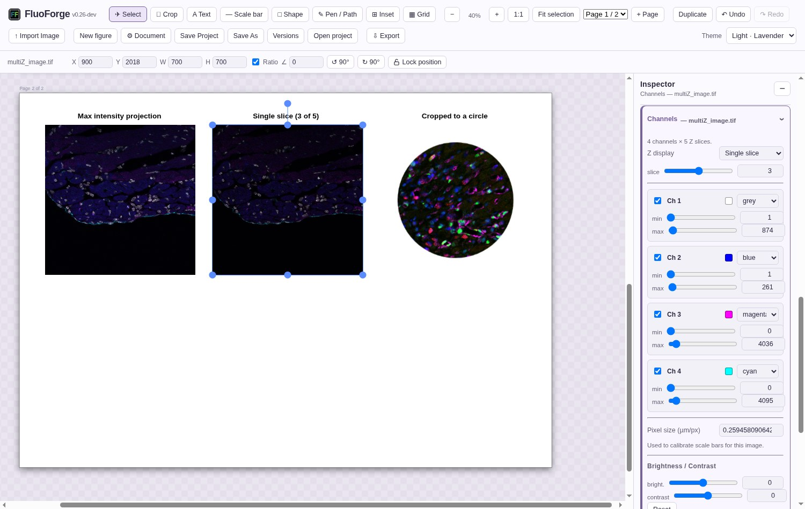

Each image (and each inset) keeps its own Z display. The choice is listed in the History panel, saved with the project and used when exporting. TIFFs without an ImageJ header or OME-XML still open with one channel per page.

### Series montage (a strip or grid of slices or frames)

**Series** in the top bar turns the selected Z stack or time series into a strip or grid of panels, one per chosen slice or frame. The dialog asks for:

- **Series**: **Time frames** or **Z slices** (only those the file has; time first).
- **Show**: **Range and step**, or **Specific frames** (or **Specific slices**) to type the planes you want.
- **First**, **Last** and **Step** (range and step): the planes shown, counted from 1 as in the sliders. Step 1 shows every plane in the range; the last plane is shown when the step lands on it. By default the step shows the whole series in about eight panels. A line under the fields says how many panels this makes and which planes; a range outside the series, or more than 100 panels, is refused with a message.
- **Planes** (specific frames or slices): the planes to show, typed as numbers and ranges: `1, 2, 5, 10` or `1, 5, 12-20`. Commas, semicolons or spaces separate them. The panels follow the order you type; `20-15` counts down, and a plane may come more than once. The field starts with the range's planes, to edit. A plane outside the series, text that is not a number, an empty list or more than 100 panels is refused with a message.
- **Layout**: **Strip (one row)**, or **Grid** with a number of **Columns** (filled row by row).
- **Gap (mm)**: the space between panels (1 mm by default).
- **Labels**: each panel gets a label linked to it (see [Annotations](#annotations-arrows-markers-rois-linked-labels)) in its top-right corner (time) or bottom-left corner (Z): its time ("t = 1:30 min", from the frame interval in the file or typed in the Channels panel; "t 6/40" without one) or its depth ("z = 3.5 µm" from the first slice; "z 8/25" without a Z step). The labels share one size, smaller when the panels are narrow.

The image becomes the first panel. The montage keeps the image's place and size, scaled down when needed so it fits in the page with the same margin on the right and below as on the left. The panels are views of the same image, stored once in the project, and are linked: a crop, **Uncrop**, a channel's range, LUT, gamma, invert or on/off, and brightness and contrast reach every panel. Each panel keeps its own plane along the series; the other axis is shared, so choosing the Z display (or a slice) on one panel of a time series shows it on all of them, and choosing a frame on one panel of a Z series does too. Choosing a new frame on one panel of a time series (or a slice in a Z series) changes that panel only, and its label follows. A Z series shows single slices, not projections.

The whole montage is one History step. **Replace image…** on a panel keeps each panel's plane (the last plane when the new file has fewer), and **Save as template** keeps each panel's place in the series. Copying and pasting panels makes a separate montage. An image that is rotated, inside a group, cropped to a shape or already part of a quick figure or series is not used.

## 6. Laying out panels with the Grid tool

The usual layout of a fluorescence figure is single channels next to the merge, one row per condition. A **grid** holds it together: it stays on the page, so panels can be swapped, rows added and the whole figure resized to a journal column without arranging anything again.

1. Import each image once per panel you want (or use **Duplicate**, Ctrl+D, or **Quick figure** below), and set each copy's channels in the Channels panel.
2. Select the images in reading order (or select none to use every image), then click **Grid**.
3. Set **Rows** and **Columns** (empty: up to 4 columns), the **Width** of the whole grid in mm (empty: the size of the first image), the **Gutter** between cells and the **Margin** around them in mm, whether to add **Column labels** above and **Row labels** on the left, and whether panels **Fit** their cell or **Fill** it, then click **Make grid**.

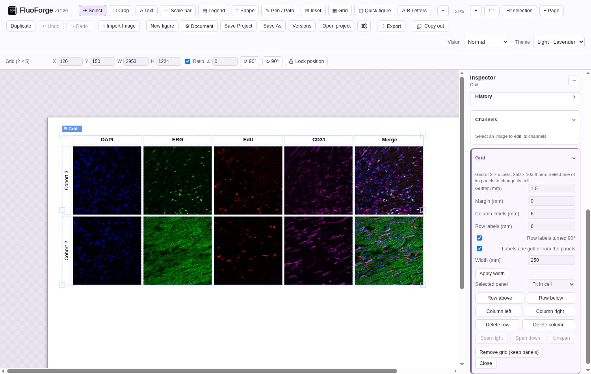

The grid is drawn as dashed cells in the editor only; exports show its panels and labels, never the grid itself. Locked images, images in a group and images already in a grid stay where they are.

- **Swap panels**: drag a panel onto another cell; the two change places. Onto an empty cell, the panel moves there. Dropped outside the grid, it leaves the grid. A free image dropped onto an empty cell joins the grid.
- **Select the grid**: click the blue **Grid** tab above its top-left corner. It always selects the grid itself, even where panels, labels or text boxes lie on top of it. With one of its panels or labels selected, **Select grid** in the Grid panel does the same from the keyboard. The tab is shown in the editor only.
- **Move the grid**: drag its **Grid** tab (or a gutter or an empty cell); its panels and labels follow.
- **Resize to a width**: select the grid (or one of its panels) and type a **Width** in mm, for example 85 for one journal column, then **Apply width**; or drag the grid's left or right handle. The panels are rescaled; gutters, margins and label bands keep their size.
- **Rows and columns**: with a panel selected, **Row above**, **Row below**, **Column left**, **Column right**, **Delete row** and **Delete column** act on its row or column (with the grid itself selected: at the bottom or the right). Panels in a deleted row or column leave the grid and stay on the page.
- **Spans**: **Span right** and **Span down** let the selected panel's cell take the empty cell next to it; **Unspan** goes back to one cell.
- **Fit or fill**, per panel: fit shows the whole image as large as it fits, centred; fill covers the cell and crops the image around its crop centre. Back to fit, the crop comes back. Cropping a panel with the Crop tool keeps it in its cell.
- **Labels** belong to the grid: they sit in the label bands (set their size in mm, 0 for none), move with it and come back to their band if dragged away. Edit their text like any text box. Removing the grid removes its labels.
- **Row labels turned 90°**: row labels read from bottom to top along their row, as is usual in figures; untick it for flat, right-aligned labels. **Labels one gutter from the panels** leaves a gutter between the label bands and the panels, so a label with a border or background does not touch the images. New grids have both; a grid made with FluoForge 0.1.26 or 0.1.27 keeps its layout until you tick them.
- **Remove grid (keep panels)** takes the grid and its labels away and leaves the panels where they are. Copying a grid copies its panels and labels too.

Panels of a Quick figure can go into a grid: in fill mode, cells of the same size give them the same crop, and cropping one still crops them all.

### Quick figure (split-channel montage)

**Quick figure** does the same in one step, from the image itself. Select one or more images and click **Quick figure** in the top bar. Each image becomes a row: one panel per channel, then the merge (the image itself), with column headers above the first row naming each channel in its colour.

- **Channels**: which channels get a panel and appear in the merge (by default, the ones shown).
- **Channel panels**: in colour, or in grey (the merge keeps the colours, and the headers name each colour).
- **Merge**: last or first.
- **Gap (mm)**: the space between panels on the printed figure (1 mm by default).

The row fits the page's width. The panels are views of the same image, stored once in the project, and stay linked: changing a channel's range, LUT, gamma or invert, or the brightness and contrast, on any panel changes it on all of them (a grey panel stays grey). Cropping one panel (or **Uncrop**) crops the whole row, which is laid out again with the same gap. Turning channels on or off stays per panel. The headers are ordinary text boxes. Copying and pasting panels of a quick figure makes a separate one: the copies stay linked to each other, not to the panels they were copied from. An image that is rotated, inside a group or cropped to a shape is not used; straighten or ungroup it first.

### Panel letters

Select the panels (or a grid) and click **Letters** in the top bar: they are lettered **A, B, C…** in reading order, page by page, row by row and left to right (panels that overlap by at least half their height are one row, whether aligned at the top, centred or at the bottom). The **Panel letters** panel opens.

- **Style, once per document**: upper or lower case, bold, size in pt, the corner (top left, top right, bottom left, bottom right), inside the panel or outside it (above or below), the offset in mm and the colour. Every letter follows it. By default: A, B, C in bold, 10 pt, white, 1 mm inside the top-left corner.
- **Linked to their panel**: a letter stays on its panel's corner when the panel is moved, resized, cropped or laid out by a grid or a quick figure, and the letters renumber themselves when panels are reordered (dragged, swapped in a grid), added, pasted or deleted.
- **Per panel**: select it and tick **Skip this panel** (no letter; the next panels move up), or type its **Own letter** (for example B′; it keeps its place in the order; empty it to go back to the automatic letter). Editing a letter on the canvas does the same. **Remove letters from selection** takes panels out of the lettering; deleting a letter does it for its panel.

Letters are ordinary text boxes, exported like any text; their font comes from the default text font, their size, weight and colour from the letter style.

## 7. Selecting, moving, aligning and locking

Use the **Select** tool (`V`). Click an object to select it; Shift+click or drag a rectangle to select several. A rectangle selects every object it touches; hold **Ctrl** (**Cmd** on a Mac) while dragging to select only the objects entirely inside it (the rectangle turns dashed while the key is held).

- **Move**: drag the object, or nudge it with the arrow keys (1 px; Shift+arrow moves 10 px).
- **Snapping**: while you drag, an object snaps to the edges and centre lines of the pages and of the other objects, and to the [guides](#rulers-and-guides). A dashed pink line shows the edge it snapped to. It also snaps to **equal spacing**: the same gap to its neighbour as two other objects of its row or column have, or centred between its two neighbours, with pink markers across the equal gaps. These lines are on screen only and never exported. Hold Alt to move freely. The **Snap** button in the top bar turns snapping on and off. Which edges snap, the snap distance, snapping to guides and to equal spacing are set in [Preferences](#preferences).
- **Resize / rotate**: drag the handles. Hold Shift while rotating to snap to 45°.
- **Exact values**: type **X**, **Y**, **W**, **H** and the rotation **∠** in the selection bar (page pixels). With **Ratio** ticked, the height follows the width. **↺ 90° / ↻ 90°** rotate by a quarter turn.
- **Duplicate** (Ctrl+D), **Copy / Paste** (Ctrl+C / Ctrl+V), **Delete** (Delete or Backspace).

With two or more objects selected, the bar adds **Align** (left, centre, right, top, middle, bottom), **Distribute** (horizontally or vertically) and **Group** (Ctrl+G; Ctrl+Shift+G ungroups):

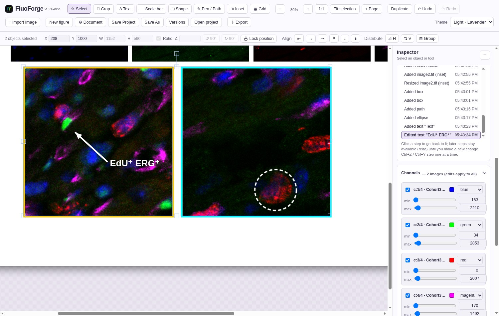

### Rulers and guides

Rulers run along the top and left of the canvas, in the document's unit: centimetres with millimetre ticks, inches with eighths, or pixels. They count from the top-left corner of the page, and the left ruler starts again at each page. The selection is shaded on both. The **Rulers** button in the top bar shows or hides them.

- **Make a guide**: drag from the left ruler onto the page for a vertical guide, or from the top ruler for a horizontal one.
- **Move a guide**: drag it on the canvas, with the Select tool.
- **Delete a guide**: drag it back onto a ruler.
- **Guides…** (top bar) lists the guides with their positions. There you can type a position to add or move one, delete one or all of them, and show or hide the guides. This is also the way to do it all with the keyboard.
- **Margin and column guides**: in **Guides…**, type a margin in mm to get dashed violet guides that far inside every page edge. A figure made for a journal in **Create figure** also gets column guides at that journal's column widths (for example 89, 120 and 183 mm for Nature), measured from the left margin. Untick them in **Guides…** if you do not want them. Journal guidelines state no page margins, so the margin is yours to choose.

Guides are saved with the project and follow undo and redo. Objects snap to them. They are drawn on screen only and never exported.

**Locks**

- **Lock position** (selection bar, or the crosshair icon in the Layers panel): the object cannot be moved, resized or rotated, but its channels, colours, text and style stay editable. Use it once the layout is final.
- **Layer lock** (padlock icon in the Layers panel): the object cannot be selected, edited or deleted at all.

Align, distribute and the grid leave locked objects where they are, and a selection containing a locked object cannot be dragged or grouped. Both locks are saved with the project and survive undo and redo.

**Editing several objects of one kind.** The Channels, Shape, Pen / Path, Inset outline, Text and Scale bar panels edit every selected object of their kind at once, and only the setting you change is copied.

## 8. Cropping an image

Select an image and choose **Crop** (`C`). Drag the blue handles, or type an exact **Width** and **Height** in pixels. Click **Apply Crop** (or **Cancel**).

**Square** makes the region a square of the image's shorter side, inside the image, and keeps it square while you resize it: dragging a side handle sets both sides to that length (the opposite side stays in place), and a corner handle resizes it from the opposite corner. If the square reaches past the edge of the image, **Apply Crop** keeps a square of the part that fits.

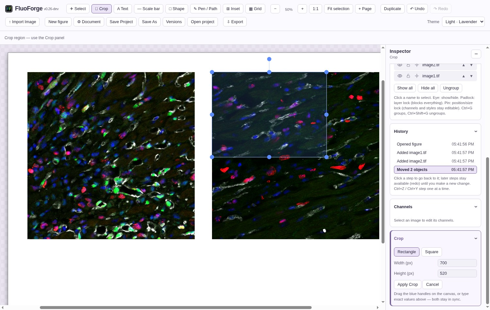

Cropping is never destructive: the full image stays in the project. **Uncrop** in the selection bar restores the full frame.

**Adjusting a crop.** To change a crop without uncropping, select the cropped panel and click **Adjust crop** in the selection bar (or choose **Crop** with it selected). The whole image is shown, dimmed outside the crop border, with the border on the current crop: drag it elsewhere, or drag its handles to make it wider, narrower, taller or shorter, then **Apply Crop**. The panel keeps its place on the page (its top-left corner) and its scale, so its scale bar stays true; the change is one step in History. Insets drawn on it stay on their part of the image, and the panels of a quick figure or series are re-cropped together, as with any crop. **Cancel** leaves the crop as it was. A border dragged past the edge of the image keeps only the part on the image. A rotated or flipped panel cannot be adjusted: set its angle back to 0° first, or use **Uncrop**.

## 9. Scale bars

Scale bars use the image's pixel size, so they stay correct when the panel is resized.

1. Choose **Scale bar** (`S`) and select the image (or several images) that should get a bar.
2. Set **Length (µm)**, **Thickness**, **Color**, **Show label**, **Corner** and **Margin** (% of the image).
3. A dashed preview appears on each selected image, and the panel tells you how long the bar will be on the page. Nothing is added yet.
4. Click **Attach to corner** (the reference image) or **Attach to corner on all selected images**.


An attached bar follows its image when you move, resize or crop it. Selecting an existing bar (with any tool) shows its length in µm, its image, that image's pixel size and the bar's length in image and page pixels; changing a field then edits the selected bar(s). The Layers panel and the selection bar also show each bar's length.

## 10. Insets

An inset is a magnified view of a region of an image. It stays linked to an outline drawn on the source image.

1. Choose **Inset** (`I`), then drag on an image to draw the outline (**Square** or **Rectangle**; hold Shift for the other). While you drag, the panel shows the outline's size on the page, in source pixels and in µm.
2. Set the outline **colour**, **width** and **dash style**, and the **Inset magnification**. New insets are created at the outline size × magnification.
3. Click **Create inset**. The inset appears next to the image; move and resize it freely.


Moving or resizing the *outline* later changes the region the inset shows, without moving the inset itself. An inset has its own channel settings, so you can, for example, show only two channels in the zoom.

**Insets of an exact size.** Tick **Exact outline size** and type a width and height (page pixels), then click on an image to place an outline of exactly that size. The fields remember the last outline, so insets on different images match. **Apply exact size to selected outline** resizes an existing outline.

## 11. Shapes

Choose **Shape** (`R`), pick **Box**, **Ellipse** or **Line**, and drag on the canvas, including on top of an image. Hold Shift (or choose **Square**) for a square or a circle. Set **Stroke color**, **Stroke width**, **Dash style** (solid, dashed, dotted, dash-dot, long dash) and an optional **Fill**. Selecting a shape shows the same panel, and its changes apply to every selected shape. To move a line's ends or bend it, right-click it and choose **Modify points**: it is edited like a path (see [Pen and paths](#12-pen-and-paths-arrows-outlines)); once you change it, it becomes a path, which keeps its look and gains the Path panel's options.

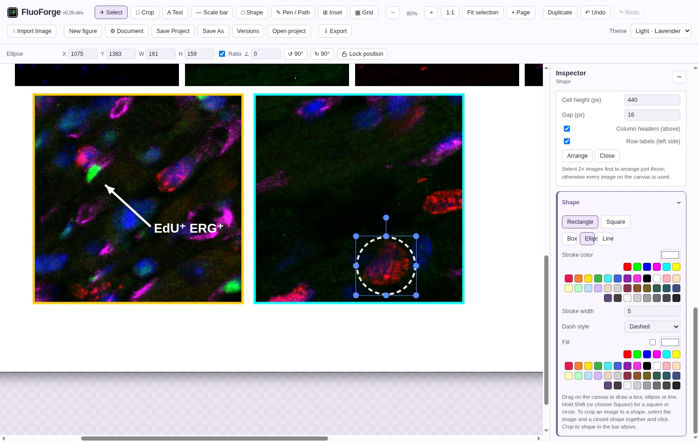

The coloured frames around insets B and C are boxes drawn with this tool, in the same colours as the outlines.

New shapes and paths start with a yellow stroke. The colour pickers offer bright colours, pastels, darker shades and greys, plus the pure ImageJ channel colours (red, green, blue, magenta, cyan and yellow), so outlines can match a channel exactly.

## 12. Pen and paths (arrows, outlines)

Choose **Pen / Path** (`P`) to draw lines, arrows and free outlines.

- Click to add a straight node; click and drag to pull out Bézier handles for a curve. Straight and curved segments can be mixed.
- Double-click or press Enter to finish, and Escape to cancel. To close the path, come back to its first node: once the path has three nodes, the first one is highlighted when the pointer comes near it and the line snaps onto it; click there to close the path.
- Shift constrains to 45° angles. Ctrl snaps to nearby nodes and object edges or centres.
- Style: colour, width, opacity, dash style, line cap and join, and an arrowhead at the start and/or end: **Filled arrow** (a solid triangle) or **Open arrow** (two strokes in the line's width, cap and join, never dashed; the line runs to the tip).
- An arrowhead is 4 times the line width long (at least 10 px), and 0.9 times its length wide. Like the line width, it keeps its size on the page when you resize the path, also when you stretch it unevenly or resize a group holding it. The line stops inside the arrowhead, near its base, so it does not show through the head and its cap never sticks out of the tip. On a curved arrow, the head follows the line under it, so the middle of its base sits on the curve.

To change a path later, right-click it and choose **Modify points** (or select it and click **Edit nodes**): drag nodes and handles, double-click a segment to insert a node, and use **Corner / Smooth**, **Delete node**, **Straight segment / Curve segment** and **Close path**. While you edit, the right-click menu also has **Add point here** (on the segment nearest to where you clicked), **Delete point** (the selected one) and **Done modifying points**. Hold Alt while dragging a smooth node's handle to break the symmetry. Escape, **Done editing** or a click outside the path returns to normal selection; the whole edit is one step in History, so one Undo takes it back.

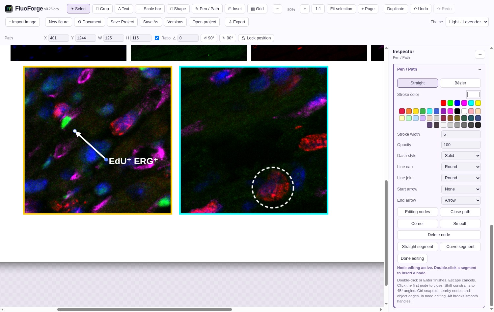

### Annotations (arrows, markers, ROIs, linked labels)

Select an image first, then choose **Annotate** (`A`). Every mark and ROI is linked to that image (or, with several images selected, to the one you click on): it moves with the image, and keeps its place on it when the image is resized (its own size stays). Drag a mark elsewhere and it keeps its new place on the image. With no image selected, a click places nothing and the panel says to select one. The **Annotate** panel sets what a click places, its **Color** (yellow by default) and **Size** (the height of a mark in pt; an arrow is three times as long):

- **Filled arrow** and **Open arrow**: a Pen path coming from the upper right, its tip on the point clicked. Edit it afterwards like any path (nodes, arrow ends, width).
- **Arrowhead only**: a filled head without a line, its tip on the point clicked, as used to point at cells.
- **Asterisk**, **Dot**, **Triangle** and **Star** markers, centred on the point clicked. They are shapes: recolour them in the Shape panel.
- **ROI box** and **ROI ellipse**: drag to draw a dashed outline (or dotted, long dash or solid: **ROI outline**). Shift keeps it square or round. Each ROI gets a label, "ROI 1", "ROI 2" (the first free number), just above it. The label follows the outline when you move or resize it; drag the label elsewhere and it keeps its new place from the outline. Deleting the outline deletes its label.

The tool stays active for the next mark or ROI on the same image; press `V` (Select) to finish. Deleting the image deletes its marks and ROIs; a mark copied without its image is pasted as a free mark.

**Labels linked to the image.** Select an image, choose **Annotate**, then click:

- **Channels**: the shown channel names, each in its channel's colour (as the [channel legend](#channel-legend)), in the top-left corner.
- **Z position**: for a slice, its depth from the first slice ("z = 3.5 µm", or "z 8/25" when the file has no Z step); for a projection, the depth it covers ("MIP z 0–12 µm"). Bottom-left corner.
- **Time**: the time of the frame shown, frame × interval ("t = 2:30 min"). The interval comes from the file (ImageJ `finterval`, in its time unit, or OME `TimeIncrement`); type it in the Channels panel's **Frame interval (s)** when the file has none, or to replace it. Without an interval, the frame number ("t 6/40"). Top-right corner.
- **Magnification**: for an inset made with the Inset tool, how much larger it shows its source pixels than the source image does ("3×"). Bottom-right corner.

A linked label follows its image when it is moved or resized, and updates itself when you show another slice or frame, rename a channel or resize the inset. Drag it elsewhere (also outside the image) and it keeps that place. Edit its text and your text is kept from then on. Deleting the image deletes its labels; a label copied without its image is pasted as ordinary text.

## 13. Text and captions

Choose **Text** (`T`) and click where the label should go, including on top of an image, then type. To make a box of a given size, drag a rectangle instead: the text box fills it, and the text wraps inside it (the box keeps the size you drew, and grows only if the text needs more room). Click an existing text box to edit it.


- **Font, Size, Text color, Bold / Italic / Underline.** Liberation Sans, Liberation Serif and Liberation Mono are built in and embedded in PDF exports; change other fonts to one of these before exporting a PDF. The list names them by the font they replace: they have the metrics of Arial, Times New Roman and Courier New, so text keeps its width and line breaks where a journal asks for those fonts. **Size** is in pt at print size (or px, see [Preferences](#preferences)).
- **Box**: a text box has its own width and height, independent of the font size. Drag the side and top/bottom handles (or type W/H in the selection bar) to resize the box; corner handles scale the text itself. The **Size** field always shows the real font size. While you resize, the moving edge snaps to the guides, page edges and other objects, as it does when you move the box; untick **Snap when resizing** in the Text panel (or in [Preferences](#preferences)) to resize freely, or hold Alt.
- **Alignment**: left / centre / right, and **Top / Middle / Bottom** inside the box. **Center both** centres it both ways.
- **Box background** and **Box border** (with **Border width**) turn a text box into a caption or a label patch.
- **Styling part of the text**: double-click into the text, highlight some words, and use the controls (colour, bold, italic…). Gene names in italics and coloured words are made this way.
- **Superscript and subscript** (x² and x₂): highlight the characters (Ca²⁺, CO₂) and click the button; click it again to take it off. With nothing highlighted, it applies to the whole box. A superscript or subscript keeps its size and shift relative to the text when you change the font size, and exports at the same place in SVG, PDF and TIFF.
- **Special characters**: open **Special characters** under the style buttons and click µ, °, ±, ×, ≤, ≥, Greek letters (α–ω, Γ, Δ, Σ, Φ, Ψ, Ω), arrows (← → ↑ ↓ ↔ ↕) or other signs (•, –, —, †, ‡, §, ∞, √): the character goes in at the caret, or replaces the highlighted text, and you can go on typing. Every one of them is in the three Liberation fonts, in all four styles, so PDF export embeds it.


### Channel legend

Choose **Legend** (`L`) to open the **Channel legend** panel, select an image and click **Add legend to selected image**: a text box lists the image's shown channels, each name in its channel's colour (for example **FLAG** in green and **WGA** in red). The colour is the channel's colour table at its maximum, so a green channel is written in pure green and a viridis channel in yellow. Hidden channels are left out. Select several images to add a legend to each. Choosing the tool adds nothing by itself; the button is greyed out until an image is selected.

While the tool is active, the **Channel legend** panel sets up the next legend:

- **Background**: black (default), white or transparent. On black or white, a colour that would not show (white or yellow on white, black on black) is written in black or white instead.
- **Border**: on (default) or off, and its colour (black by default).
- **Size from**: **Image width** puts the box right above the image, as wide as the image is displayed (after cropping and resizing, not its source pixels). **Image height** turns the box 90° against the image's left side, as long as the image is tall.

With the tool active, click another image and **Add legend to selected image** again. The text shrinks if the names would not fit on one line.

The tool only creates the legend: the result is an ordinary text box, not linked to the image. Rename the channels, change colours, background or border afterwards with the [Text panel](#13-text-and-captions), like any text; the legend options never change an existing text box, so your edits are kept.

## 14. Cropping an image to a shape

To show an image inside a circle, an ellipse or any closed outline:

1. Draw a box, an ellipse (Shift for a circle) or a closed pen path over the image.
2. Select the image and the shape together. **Crop to shape** appears in the selection bar.

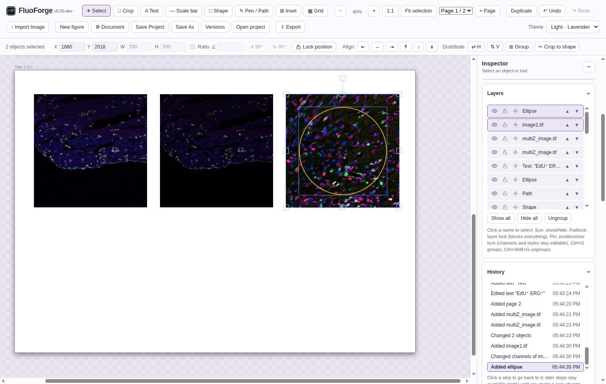

3. Click **Crop to shape**. The image frame is cropped to the shape, and the shape becomes the image's clipping path. It moves, scales and rotates with the image and stays a true vector clip in SVG and PDF.

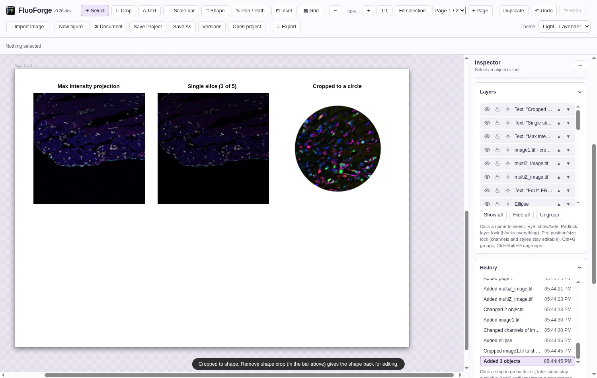

**Remove shape crop** (selection bar) gives the shape back as an editable shape and restores the image's previous frame.

## 15. Pages and document properties

A figure can have several pages of the same size. **+ Page** (top bar) or **Add page** (Document Properties) adds a page below the last one; the page menu next to it scrolls to a page. Objects can be dragged between pages, and scale bars and insets keep working across pages.


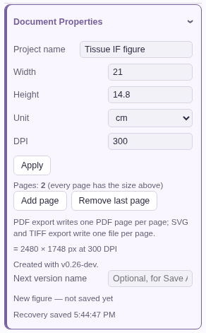

Click **Document** (or open the **Document Properties** panel) to change:

- **Project name**, **Width**, **Height**, **Unit**, **DPI**: click **Apply**. The pixel size of the page at that DPI is shown below. Choosing another **Unit** converts the width and height to it (pixels use the DPI); the numbers are shown to two decimals, but the exact size is kept, so switching back or applying does not change the page by a pixel.
- **Add page / Remove last page** (removing a page that still has objects asks first).
- **Next version name**: an optional name for the next **Save As** version.
- The save status, and the time of the last browser recovery checkpoint.

<br clear="right">

## 16. Layers

The **Layers** panel lists every object, frontmost first. Click a name to select the object; the ▲ / ▼ arrows move it forward or backward.


Each row has three toggles:

- **Eye**: show / hide (**Show all** / **Hide all** for every object).
- **Padlock**: layer lock (cannot be selected, moved, edited or deleted).
- **Crosshair**: position/size lock (cannot be moved, resized or rotated; channels, colours and text stay editable).

Images in a comparison group (section 4) show a chain icon after their name, and a ⚠ badge when the group's settings differ; click the badge to match the group to that image.

**Ungroup** splits a selected group.

<br clear="right">

## 17. Undo and the History panel

Every change is a step in the **History** panel, with a readable name and its time ("Added image1.tif", "Moved scale bar 50 µm", "Changed channels of 2 objects", "Changed Z plane of …", "Cropped image1.tif to shape"). Click a step to go back to it. Later steps stay listed for redo until you make a new change. **Undo / Redo** (Ctrl+Z, Ctrl+Y or Ctrl+Shift+Z) move one step at a time, and up to 200 steps are kept.

## 18. Saving, versions and recovery

- **Save Project** (Ctrl+S) writes a `.fluoforge` file containing the editable figure and one copy of every original image, so you can reopen it later and change anything. In Chrome and Edge you pick the file once and later saves overwrite it; other browsers download a new copy each time.
- **Save As** saves to a new file as a new version that keeps the earlier history.
- **What is in the file**: a `.fluoforge` file is a zip with `manifest.json`, one editable state per saved version under `versions/`, and one copy of every distinct original image under `sources/`. **Save Project** updates the current version; **Save As** adds a child version.
- **Versions** lists the versions stored in the project and lets you restore one.
- **Open project** opens a `.fluoforge` file. Projects saved by older FluoForge versions open too: `.mfcproj.zip` files (FluoForge up to 0.1.2) and the older `.mfcproj.json` and `.gz` formats (v0.18–v0.19). Saving such a project writes a `.fluoforge` file; a project that was opened from a file in Chrome or Edge keeps saving to that file until you use **Save As**. In v0.18–v0.19 projects, scale bars and groups are converted, and a scale bar's length is read from its label.
- **Converted projects keep their original.** The first time you save a project that had to be converted from an older format, the version you opened stays in the file unchanged and the converted figure is saved as a new version ("Updated by FluoForge …"). **Versions** lists both, so you can go back.
- **Projects from a newer FluoForge** open with the message "Saved by FluoForge v…; some content may not display": this version shows what it understands. Saving keeps everything else unchanged, so the newer version still finds it. Export is refused while the figure holds content this version cannot draw; export it with the newer version.
- **Storage**: below the recovery status, FluoForge shows how much browser storage it uses and how much is available. After the first recovery draft it asks the browser to keep this data (Firefox may ask you for permission; allowing it stops the browser from clearing drafts when space runs low). If the browser storage is full, the recovery status says so and drafts pause; your figure is not affected, so save it to a file. Drafts resume when space is freed.
- **Recovery**: while you work, the browser keeps recovery checkpoints. If the tab is closed or crashes, FluoForge offers to recover the draft the next time it opens (only when the draft is newer than your last save). Recovery drafts are not a replacement for saving, and they do not become project versions until you save.
- Closing or reloading the tab with unsaved changes asks for confirmation.

## 19. Exporting the figure

**Export** offers four formats, the **Export…** dialog, **Export panels (zip)** and a [figure report](#figure-report-methods-and-adjustments). The four format items export every page at the document resolution in one click.

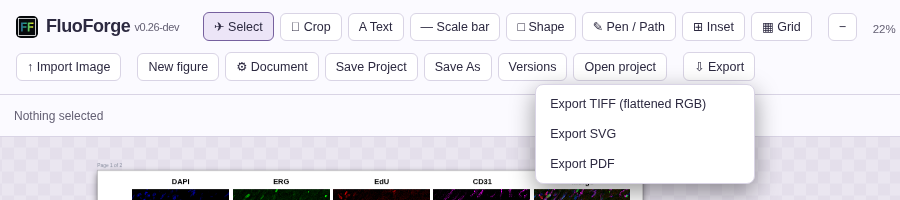

| Format | What you get | Use it for |
|---|---|---|
| **TIFF (flattened RGB)** | One RGB image per page, losslessly compressed (Deflate by default), with the DPI written in the file. | Journals that want raster figures. |
| **PNG** | One image per page, with the DPI written in the file. | Slides, the web, quick previews. |
| **SVG** | One file per page, at the page's real size (in mm, or in cm or inches for documents in those units), so Inkscape and Illustrator open it at the right size at any DPI. Text, shapes, paths, arrows, scale bars and clip paths stay as vectors; each image is embedded (cropped) at the output resolution, never enlarged beyond its source pixels. | Final touches in Inkscape or Illustrator. |
| **PDF** | One PDF with one page per figure page; vectors stay vectors and the Liberation fonts are embedded. | Submission and sharing. |

Images are always re-composited from the original channel data at full resolution, never from the screen preview. A panel printed smaller than its source is averaged down from the source pixels; a panel printed larger keeps its source resolution and is never enlarged. Dashed outlines keep their dash lengths in Inkscape and when resized. Export files are named after the project (characters that are not allowed in file names are replaced), and multi-page SVG, TIFF and PNG exports add `_page-1`, `_page-2`, … Objects on the pasteboard (outside a page) are not exported.

### The Export dialog

**Export ▸ Export…** sets everything before exporting, and shows the [figure check](#checking-the-figure-before-export) summary (it never blocks an export):

- **Format**: TIFF, PNG, SVG or PDF.
- **Pages**: all, the page you are looking at, or a list such as `1-3, 5`. PDF puts them in one file; the others write one file per page.
- **Resolution** for TIFF and PNG, from the document's, in the unit chosen next to it: **dpi** or **ppi** (per inch; for a digital image they are the same number) or **dpc** or **ppc** (per centimetre). Changing the unit converts the value, so 300 dpi becomes 118.11 ppc. The allowed range is 30 to 2400 dpi (11.81 to 944.88 per cm). A TIFF exported in dpc or ppc stores its resolution in pixels per centimetre, so ImageJ and other programs show the value you typed; a PNG always stores pixels per metre, at the same resolution. Above the document's resolution, panels printed smaller than their source get more of their source pixels; no image is ever enlarged beyond its source.
- **Transparent background** for TIFF (RGB with alpha), PNG and SVG: the empty page is left transparent instead of white.
- **TIFF compression**: Deflate (smallest), LZW (for older software) or none. All three are lossless.
- **Include the figure report**: also saves `<figure>_report.md` and `<figure>_report.json`.

The dialog remembers your choices until you close the page.

### Exporting the panels

**Export ▸ Export panels (zip)** writes `<figure>_panels.zip` with, for every image panel on the pages:

- `<letter>_merge.png`: the panel's crop at source resolution, as displayed (channels, LUTs, ranges, gamma, invert, brightness and contrast);
- `<letter>_<channel>.png`: each shown channel alone in grey, through its own display range, gamma and invert.

The letter is the one- or two-letter label (`A`, `b`, `(c)`) nearest the panel's top-left corner; panels without one are named `panel-1`, `panel-2`, … Each PNG records the pixel size when it is set. The zip also holds `figure-report.json` and a `README.txt` describing each file. Crop-to-shape masks are not applied to these PNGs.

### Copying to other software

**Copy out** (top bar, next to Export), **Export ▸ Copy for other software…**, the right-click menu or Ctrl+Shift+C put the figure on the clipboard, rendered from the source data like an export, to paste into PowerPoint, Word, Keynote, Inkscape, Illustrator, Figma or an e-mail with Ctrl+V.

- **What**: the page you are looking at, or the selected objects, cropped to their box (chosen when something is selected). Right-click an object for **Copy for other software…** on the selection, or an empty part of a page to copy that page; the Menu key and Shift+F10 open the same menu.
- **As**:
  - **Vector picture (SVG)**: stays sharp at any size, for PowerPoint, Word, Keynote, Inkscape and Illustrator.
  - **Bitmap (PNG)**: pixels at the resolution you choose (the document's by default), for any program.
  - **Both**: SVG and PNG together; each program pastes the one it reads. The default.
  - **SVG code (text)**: the SVG source, which Figma, Inkscape and Illustrator paste as editable vectors.
- **Transparent background**: leave the background clear instead of white.

Browsers allow copying pictures only on `https://` and `localhost` pages, so a FluoForge opened as a file (`file://`) cannot copy: use Export there. Firefox cannot put SVG pictures on the clipboard; it copies the SVG code instead (and, for **Both**, the PNG). When an SVG picture is copied, the browser removes its embedded fonts: the text keeps its font name, and the other program uses that font if it is installed on the computer (install the Liberation fonts, or paste the PNG, for an exact look).

### Figure report (Methods and adjustments)

**Export ▸ Figure report…** lists, for every image panel on the pages (insets included, hidden objects and the pasteboard left out):

- the source file: name, SHA-256 checksum (the same one the project uses to store it), format, dimensions, channels, Z slices, time frames, bit depth, and pixel size with where it came from;
- the crop, in source pixels (and in µm when the pixel size is set), and the shape of a crop-to-shape mask;
- the Z projection (maximum or mean of all slices, or the single slice) and the time frame;
- every channel: name, whether it is shown, LUT, display minimum and maximum, gamma and invert;
- brightness and contrast, rotation and flip;
- the printed size in mm and the effective resolution: source pixels per printed inch, against the document DPI, and the size in pixels the export writes. A panel below the document DPI is flagged (exports never enlarge images, so such a panel prints with its own pixels).

The dialog shows a **Methods paragraph** built only from these values: click **Copy paragraph** and paste it into your manuscript, then check it. **Markdown**, **CSV** (one row per channel of each panel, for a spreadsheet) and **JSON** download the full report as `<figure name>_report.md`, `.csv` or `.json`. The report contains no date, so the same figure always gives the same report.

Exports carry the report with them: each **SVG** has the JSON of the panels on its page in a `<metadata id="fluoforge-report">` element, and a **PDF** has the JSON of the whole figure in its *Subject* document property (with the figure name as *Title* and FluoForge as *Creator*), so a figure file keeps its own provenance. File names in the report are as they were imported, so they can reveal how your files are named.

### Checking the figure before export

The **Check figure** panel in the Inspector reviews the figure every time it changes (click **Check now** to run it at once), and the top of the **Export** menu shows the same summary with a **Review** button. Nothing here blocks an export.

| Finding | Severity |
|---|---|
| An image has a pixel size but no scale bar, on it or on another panel of its row | Warning |
| An image has no pixel size | Info |
| Red and green are both shown in one merged panel (use magenta and green) | Warning |
| A panel has no text label near it, at the start of its row or above its column | Warning |
| Panels of a comparison group show a different range, LUT or gamma | Error |
| More than 1 % of a shown channel's pixels (in the panel's crop) are at or above its maximum, or at or below its minimum | Warning |
| A channel's gamma is not 1, or brightness or contrast is not 0: state it in the legend or Methods | Info |
| A panel is printed larger than its source pixels, or below 300 dpi | Warning |
| Text is smaller than 5 pt or larger than 8 pt at print size | Warning |
| An inset's outline on its source panel is hidden or deleted | Warning |
| An object is on the pasteboard and will not be exported | Info |
| An empty frame (from a [template](#templates)) is waiting for an image and will not be exported | Info |

Errors come first, then warnings, then information. Click a finding to select its object (or every panel of a comparison group). The text size and resolution limits are the default ones (5–8 pt, 300 dpi), or those of the journal chosen in **Create figure**; the panel says which. A journal that states no maximum text size gets none.

To dismiss a finding for this project, click **Dismiss…**, type why (for example "printed at the journal's column width") and press Enter. Dismissed findings are listed under **Dismissed**, where **Restore** brings one back. They are saved with the project, follow undo and redo, and appear with their notes in the figure report.

## 20. Themes

**Theme** (top right) switches the interface between Light · Lavender, Light · Sage, Dark · Plum and Dark · Slate. It does not change the figure, and the choice is remembered in this browser.


### Colour-vision and grey-scale preview

**Vision** (next to Theme) shows the canvas as people with a colour-vision deficiency see it: **Deuteranopia** (no green cones, the most common), **Protanopia** (no red cones) and **Tritanopia** (no blue cones), or in **Grey-scale**, as in a black-and-white print. Use it to check that red and green, or a LUT, can still be told apart.

It is a view only. The figure, the project, undo and the exports do not change, and the choice is not remembered: FluoForge always starts in normal colours. While a preview is on, a badge over the canvas says so; click its **Normal** button (or choose Normal) to turn it off. The simulations use the matrices of Machado, Oliveira and Fernandes (2009) at full severity; grey-scale uses relative luminance (Rec. 709).

### Preferences

**Preferences** (the sliders button in the top bar, next to Open project, or Ctrl+,) opens a window above the canvas and the panels. Changes apply at once.

| Section | Preference | Default |
|---|---|---|
| Snapping | Snap while dragging | On |
| | Snap to the page; snap to other objects | On; on |
| | Snap these edges: left, centre (the vertical centre line), right, top, middle (the horizontal centre line), bottom. Left, centre and right line up horizontally; top, middle and bottom vertically. Tick only *Top*, for example, to align tops and nothing else. | All |
| | Snap distance, in pixels on screen (the same at every zoom) | 8 |
| | Show snap guides | On |
| | Snap to guides (the guides, and the margin and column guides) | On |
| | Snap to equal spacing (the same gap as two other objects, or centred between neighbours) | On |
| Text | Default font, size (document px) and colour of new text boxes; **Snap when resizing** (also in the Text panel) | Liberation Sans, 24, black; on |
| Rulers and guides | Show rulers; show guides | On; on |
| Units | Size units: **mm and pt** (positions and sizes in mm; stroke, outline and border widths, scale bar thickness and font sizes in pt, at the document's DPI) or **Document px** | mm and pt |

A preference is **global**: it is saved in this browser and used by every project. Tick **This project only** on a row to give the open project its own value: it overrides the global preference in this project only, is saved with the project and follows undo and redo, and the row shows the global value beside it. Untick it to go back to the global value. **Reset global preferences** sets every global value back to its default; values of the open project are kept.

## 21. Keyboard shortcuts

| Keys | Action |
|---|---|
| `V` | Select tool |
| `C` | Crop tool |
| `T` | Text tool |
| `S` | Scale bar tool |
| `R` | Shape tool |
| `P` | Pen / Path tool |
| `I` | Inset tool |
| `L` | Channel legend tool |
| `A` | Annotate tool (arrows, markers, ROIs, linked labels) |
| `+` / `-` | Zoom in / out (around the selection) |
| Ctrl+, | Preferences |
| Ctrl+Shift+C | Copy for other software |
| Alt (while dragging) | Move without snapping |
| `0` | Zoom to 100 % |
| Shift+2 | Fit the selection in the view |
| Ctrl + mouse wheel | Zoom around the selection or the cursor |
| Arrow keys / Shift+arrows | Nudge by 1 px / 10 px |
| Ctrl+Z | Undo |
| Ctrl+Y or Ctrl+Shift+Z | Redo |
| Ctrl+D | Duplicate |
| Ctrl+C / Ctrl+V | Copy / paste |
| Ctrl+G / Ctrl+Shift+G | Group / ungroup |
| Menu key or Shift+F10 | Image menu (copy and paste display settings) |
| Ctrl+S | Save project |
| Delete or Backspace | Delete the selection (locked objects are kept) |
| Shift (while drawing) | Square / circle; 45° for paths and rotation |
| Ctrl (Pen tool) | Snap to nodes and object edges |
| Alt (editing nodes) | Break a smooth node's handles |
| Enter / Escape (Pen tool) | Finish / cancel the path |

## 22. Tips and troubleshooting

- **A stack opens as many channels.** The file has no ImageJ hyperstack header (or its header does not match the number of pages). **Image info** shows the header and says when it does not match. In Fiji, use *Image ▸ Hyperstacks ▸ Stack to Hyperstack* and save as TIFF.
- **Checking what was read from a file.** Select the image and click **Image info** in the Channels panel. For more detail, open FluoForge with `?debug=1` at the end of the address (or run `localStorage.fluoforgeDebug = '1'` in the browser console and reload): the TIFF reader then prints everything it decodes to the console. Importing is silent otherwise.
- **No scale bar can be added.** The image has no pixel size. Type it in the Channels panel (**Pixel size (µm/px)**).
- **Comparing conditions.** Select all panels of one channel and set the same *min / max*: the multi-image edit copies only the value you change.
- **PDF text looks different.** Only the Liberation fonts are embedded in PDF; switch labels to Liberation Sans, Serif or Mono.
- **Large images feel slow.** The editor shows a reduced preview above 2048 px; exports still use the full resolution.
- **"needs about … of memory" when importing.** FluoForge estimates the memory an image needs (width × height × planes × bytes per sample) and asks before opening one that would exceed what the browser seems to have left. Opening it anyway may crash the tab: save first, or close other tabs.
- **"The image … inside this project is damaged".** Every image in a project is stored with a checksum, and this one no longer matches: the project file was damaged, for example by an incomplete copy. Open an earlier copy of the project.
- **A file cannot be imported.** The message says why, for example "is not a TIFF file" or "is damaged or incomplete" (often a file that was not fully copied or downloaded). Nothing is added to the figure. For a microscope format (CZI, LIF, ND2, ...), a BigTIFF or a sample type FluoForge does not read (such as 16-bit float), the message links to the Fiji conversion macro (see [Importing images](#3-importing-images)).
- **"Unexpected error" message.** Something went wrong inside FluoForge. The figure stays editable; save it, then use **Copy details** and paste the report into a bug report. **Dismiss** or Escape closes the message.
- **Lost work.** Reopen FluoForge in the same browser: a recovery prompt appears if a draft newer than your last save exists. Save projects regularly anyway: browser storage can be cleared.
